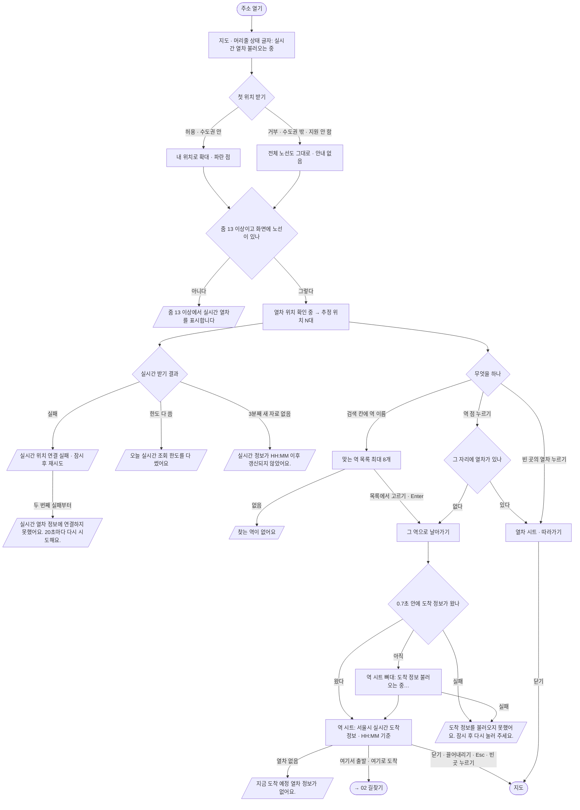

# 01 처음 열기 · 지도 · 역 검색 → 역 정보

지도를 열어 실시간 열차를 보고, 역을 찾거나 눌러 그 역의 곧 오는 열차를 보는 흐름. 길찾기(02)로 넘어가는 입구도 여기 있다.

화면 기획(조립 화면 · 번호 설명 · 흐름 한 장)은 스토리북 **화면 기획** 에 있다 — `npm run storybook` → [`화면-기획--flow-01`](http://localhost:6006/?path=/story/화면-기획--flow-01). 설명 원본은 `docs/flows/screens/01-map-search-station/*.json`.

## 시작점
- 주소를 연다(첫 방문 · 다시 방문 같음)
- 이미 열린 지도에서 검색 칸 「어느 역으로 슝?」 또는 지도 위 역 · 열차를 누른다

## 흐름도

## 단계
1. **지도 열기** — 머리줄 상태 글자는 「실시간 열차 불러오는 중」으로 시작한다(`web/index.html:46`).
2. **첫 위치** — 처음 그려질 때 위치를 한 번 묻는다. 수도권 상자 안이면 내 위치 단추를 누른 것처럼 확대하고, 거부 · 수도권 밖 · 위치 기능 없음이면 전체 노선도 그대로 둔다(안내 없음).
3. **실시간 열차** — 줌 13 이상에서 화면에 보이는 노선의 열차를 받는다. 상태 글자: 「… 열차 위치 확인 중」 → 「추정 위치 N대 · 노선 · 시각」. 지도를 옮기면 0.6초 뒤, 그 밖에는 10초마다 살펴 19초가 지났거나 열차 시트가 열려 있으면 다시 받는다.
4. **역 찾기** — 검색 칸에 치면 0.12초 뒤 맞는 역(끝의 「역」은 떼고 비교 · 같은 이름 → 앞이 같은 이름 → 짧은 이름 차례)을 8개까지 보여 준다. ↑ ↓ 로 고르고 Enter, Esc 로 닫는다(한글 조합 중 Enter 는 무시).
5. **역 고르기 · 역 누르기** — 그 역으로 날아가며(줌 15 이상) 역 시트를 연다. 역 점을 눌렀는데 14px 안에 열차가 있으면 열차 시트가 먼저다.
6. **역 시트** — 노선 칩 · 역 이름 · 상태 줄 · 「여기서 출발」 「여기로 도착」 · 곧 오는 열차(노선 · 방향마다) · 출구(휠체어 표시). 받은 자료로 15초마다 다시 그린다(다시 받지는 않는다).
7. **열차 시트** — 누른 열차를 따라가며 1초마다 상태 줄을 다시 그린다. 지도를 끌면 따라가기가 풀린다.

## 갈림길
| 갈림길 | 동작 · 문구 |
|---|---|
| 불러오는 중 | 머리줄 「… 열차 위치 확인 중」 / 역 시트는 0.7초까지 기다렸다가 뼈대 줄 + 「도착 정보 불러오는 중…」 |
| 실시간 자료 끊김 | 머리줄 「실시간 위치 연결 실패 · 잠시 후 재시도」, 두 번째 실패부터(또는 그린 열차가 없으면) 지도 위 띠 「실시간 열차 정보에 연결하지 못했어요. 20초마다 다시 시도해요.」 · 3분째 새 자료가 없으면 「실시간 정보가 HH:MM 이후 갱신되지 않았어요.」 · 한도 소진 「오늘 실시간 조회 한도를 다 썼어요. 내일 첫차 무렵부터 다시 보여요.」 · 일부 지연 「실시간 정보 일부가 지연되고 있어요. 이전 자료로 표시 중이에요.」 |
| 도착 정보 실패 | 역 시트 상태 줄 「도착 정보를 불러오지 못했어요. 잠시 후 다시 눌러 주세요.」(다시 받기 단추는 없다 — 역을 다시 누른다) |
| 위치 권한 없음 | 첫 방문: 안내 없이 전체 노선도 / 내 위치 단추를 눌러 거부되면 지도 위 띠 「위치를 가져오지 못했어요. 브라우저의 위치 권한을 확인해 주세요.」 |
| 줌이 낮음 · 노선 없음 | 「줌 13 이상에서 실시간 열차를 표시합니다」 / 「이 화면에는 운행 노선이 없습니다」 |
| 검색 결과 없음 | 목록에 「찾는 역이 없어요」 |
| 로그인 안 됨 · 경로 없음 | 해당 없음 |

## 끝점
- 역 시트 · 열차 시트를 닫고 지도로(✕ · 끌어내리기 · Esc · 빈 곳 누르기 — 길찾기처럼 「하는 중」 시트는 빈 곳을 눌러도 남는다)
- 「여기서 출발」 · 「여기로 도착」 → [02 길찾기](02-journey.md)

## 관련 코드
| 무엇 | 경로:줄 |
|---|---|
| 머리줄 · 검색 칸 · 길찾기 단추 · 지도 오류 칸 | `web/index.html:46` · `web/index.html:50-54` |
| 첫 위치 · 위치 권한 안내 | `web/maplibre_runtime.mts:350-374` |
| 지도 누르기(열차 → 버스 → 시트 닫기) · 역 점 누르기 | `web/maplibre_runtime.mts:674-675` |
| 역 검색 | `web/ui/search.mts:18-35` · 연결 `web/maplibre_runtime.mts:708` |
| 실시간 받기 · 상태 글자 · 받기 주기 | `web/trains/live_feed.mts:36-60` · `web/trains/live_feed.mts:69-72` |
| 지도 위 띠(끊김 · 3분 멈춤) | `web/ui/popups.mts:99-105` |
| 역 시트 열기(0.7초 · 15초 다시 그리기) | `web/ui/popups.mts:131-153` |
| 역 시트 그리기(받는 중 · 못 받음 · 받음) | `web/components/station_sheet.tsx:15-48` |
| 열차 시트 열기 · 열차 고르기(14px) | `web/ui/popups.mts:70-96` |
| 아래 시트(닫기 · 끌기 · Esc · 따라가기) · 길찾기 두 단추 | `web/ui/sheet.mts:39-63` · `web/ui/sheet.mts:124-125` |

## 확인 필요
- `web/index.html:54` 의 「지도를 불러오지 못했습니다. 네트워크 상태를 확인한 뒤 새로고침해 주세요.」 칸(`#error`)을 여는 코드를 `web/` 안에서 찾지 못했다 — 지금은 보이지 않는 칸으로 읽힌다. 지도 스타일 · 자료를 못 받을 때의 화면이 정해져 있는지 확인 필요
- 버스(지도 위 버스 누르기 · 버스 시트)는 이번 흐름 목록에 없어 갈림길로만 적었다
