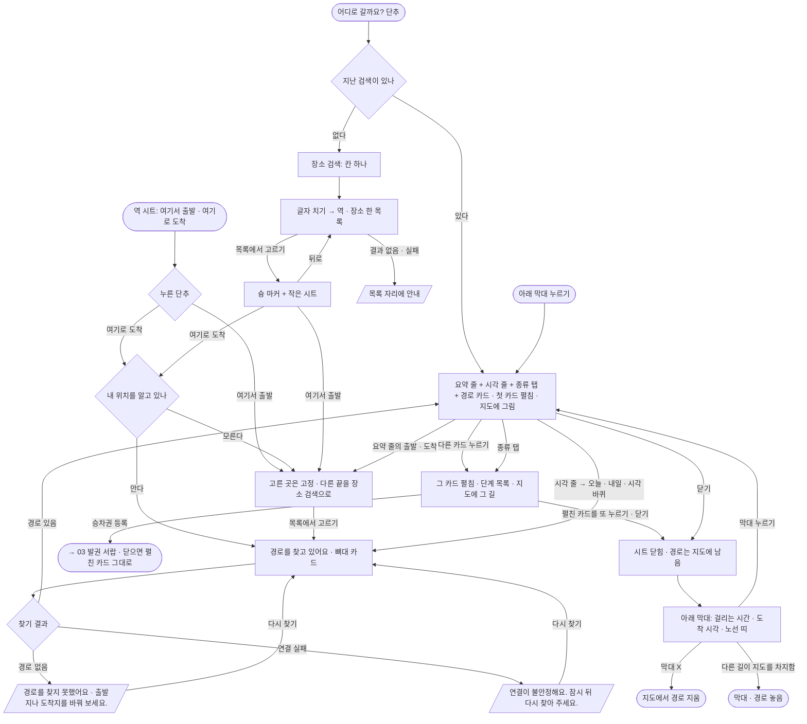

# 02 길찾기

장소를 찾아 출발 · 도착을 정하면 바로 경로를 찾고, 경로 카드를 골라 단계를 보고, 지도에 그린 채 시트를 닫으면 아래 막대로 다시 볼 수 있는 흐름. 로그인 없이 쓴다.

화면 기획(조립 화면 · 번호 설명 · 흐름 한 장)은 스토리북 **화면 기획** 에 있다 — `npm run storybook` → [`화면-기획--flow-02`](http://localhost:6006/?path=/story/화면-기획--flow-02). 설명 원본은 `docs/flows/screens/02-journey/*.json`.

## 시작점
- 지도 위 단추 「어디로 갈까요?」(`#routeButton`) — 지난 검색이 있으면 그 결과로, 없으면 장소 검색으로 연다
- 역 시트의 「여기서 출발」 · 「여기로 도착」([01](01-map-search-station.md)) — 그 역을 한쪽 끝으로 채우고 새로 연다
- 경로를 그린 채 시트를 닫은 뒤 아래 막대 「경로 결과 다시 보기」

장소를 고르는 부분의 그림과 자세한 동작은 [06 검색 합치기](06-search-merge.md).

## 흐름도

## 단계
1. **열기** — 칸 하나짜리 장소 검색이 열리고 초점이 간다. 내 위치를 알면 지도가 그리로 간다. 지난 검색이 있으면 그 결과 · 고른 카드 · 시각 그대로 연다.
2. **장소 찾기** — 역은 치는 대로, 장소는 두 글자부터 0.3초 뒤 찾아 한 목록으로 보여 준다(늦게 온 답은 버린다). 고르면 슝 마커와 작은 시트가 뜬다. 한쪽 끝이 이미 정해져 있으면 고르는 즉시 경로를 찾는다.
3. **끝 정하기** — 작은 시트의 「여기로 도착」은 내 위치를 알면 바로 찾고, 모르면 출발을 같은 방식으로 찾는다. 「여기서 출발」은 도착을 같은 방식으로 찾는다.
4. **찾기** — 찾는 동안 「경로를 찾고 있어요」와 뼈대 카드. 시각은 묻지 않고 지금 출발로 찾는다.
5. **경로 고르기** — 결과가 오면 첫 카드가 펼쳐져 지도에 그려진다. 경로 종류가 둘 이상이면 「전체 · 지하철 · 버스 · 지하철+버스」 탭이 뜬다(탭으로 고른 카드가 숨으면 첫 보이는 카드로). 요약 줄의 출발 · 도착을 누르면 그 끝을 장소 검색으로 바꾼다.
6. **출발 시각** — 기본 「지금 출발」. 시각 줄을 누르면 오늘 · 내일과 발권 화면과 같은 시각 바퀴(오전 · 오후 / 시 / 5분 단위 분)로 고르고 「이 시간에 출발」, 「지금으로」 로 되돌린다. 고를 수 있는 범위는 다음 5분 ~ 내일 23:55이고, 지난 시각에서 멈추면 가장 이른 때로 되돌린다.
7. **단계 보기** — 펼친 카드(`.jp.on`)에만 단계 목록이 보인다. 다른 카드를 누르면 그 카드가 펼쳐지고 지도의 길도 바뀐다. 맨 아래 「승차권 등록」은 목록 위에 발권 서랍을 연다([06](06-search-merge.md)).
8. **지도에서 보기** — 펼친 카드를 한 번 더 누르거나 시트를 닫으면 시트만 닫히고 경로는 지도에 남는다(안내 「경로를 누르면 지도에 보여요. 창을 닫아도 경로는 남아 있어요.」). 아래 막대가 뜬다.

## 갈림길
| 갈림길 | 동작 · 문구 |
|---|---|
| 불러오는 중 | 장소 찾기: 목록이 늦게 채워질 뿐 따로 표시 없음 / 경로: 「경로를 찾고 있어요」 + 뼈대 카드 |
| 경로 없음 | 「경로를 찾지 못했어요. {서버가 준 이유}」 — 이유가 없으면 「출발지나 도착지를 바꿔 보세요.」 · 「다시 찾기」 단추 |
| 연결 실패 | 「경로를 찾지 못했어요. 연결이 불안정해요. 잠시 뒤 다시 찾아 주세요.」 · 「다시 찾기」 |
| 장소 검색 실패 · 결과 없음 | 목록 자리에 안내([06](06-search-merge.md)) |
| 위치 권한 없음 | 「여기로 도착」을 고르면 출발을 같은 방식으로 찾는다(「어디서 출발할까요?」) · 지도는 보던 자리 |
| 실시간 자료 끊김 | 길찾기 화면에는 따로 없다 — 지도 위 띠는 [01](01-map-search-station.md) 그대로. 경로 카드 안내 「첫 열차는 실시간 위치로, 이후 열차는 배차 간격으로, 버스는 시간표로 계산한 예상 시간이에요.」 |
| 로그인 안 됨 | 해당 없음(로그인한 사람만 길찾기 횟수를 통계로 센다 — [04](04-account.md)) |

## 끝점
- 아래 막대 ✕ → 지도에서 경로를 지운다
- 승차권 경로(지도에서 보기 · 경로 고르기 — [03](03-tickets.md))가 지도를 차지하면 길찾기 경로 · 막대를 놓는다. 「어디로 갈까요?」를 누르면 반대로 승차권 경로를 지운다
- 역 · 열차 시트가 길찾기 시트 자리를 차지하면 경로는 남고 막대가 뜬다

## 관련 코드
| 무엇 | 경로 |
|---|---|
| 시작 단추 · 연결(승차권 길 지우기) | `web/index.html` `#routeButton` · `web/maplibre_runtime.mts` `initJourney` · `web/lib/journey-ui.mts` `start` |
| 아래 막대(다시 보기 · ✕) | `web/lib/journey-ui.mts` `showBar` · `web/components/journey_summary.tsx` `JourneyBar` |
| 장소 찾기 · 작은 시트 · 끝 정하기 | `web/lib/journey-ui.mts` `typed` · `placePicked` · `chooseEnd` · `changeEnd` · `web/lib/place-search.mts` · `web/components/place_search.tsx` |
| 출발 시각 | `web/lib/journey-ui.mts` `whenOpen` · `wheelMoved` · `web/lib/time-wheel.mts` · `web/components/journey_when.tsx` |
| 찾기 · 실패 문구 · `/api/route` | `web/lib/journey-ui.mts` `go` |
| 지난 검색 열기 · 역 시트에서 열기 · 뒤로 | `web/lib/journey-ui.mts` `open` · `openWith` · `back` |
| 카드 · 단계 목록 · 실패 카드 · 요약 줄 | `web/ui/journey_sheet.tsx` · `web/components/route_card.tsx` · `web/components/journey_summary.tsx` |
| 역 시트 두 단추 → 길찾기 | `web/ui/sheet.mts` `openWith` 부름 |

## 확인 필요
- 없음(이 흐름은 코드로 모두 확인)
