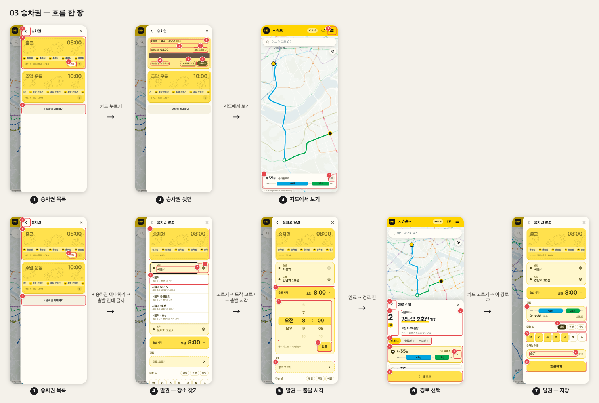
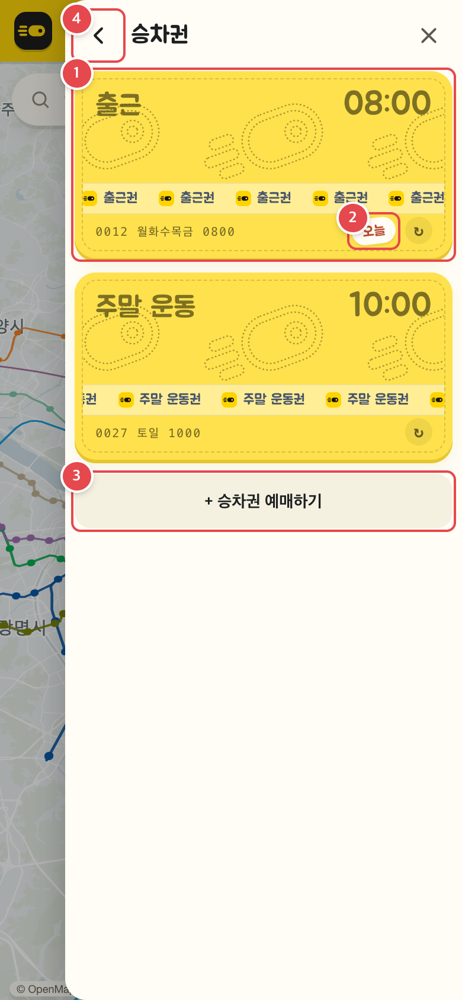
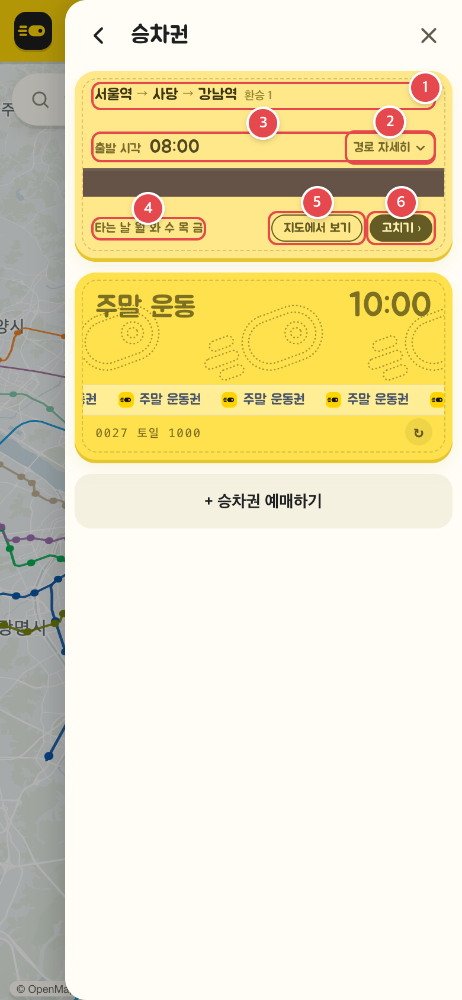
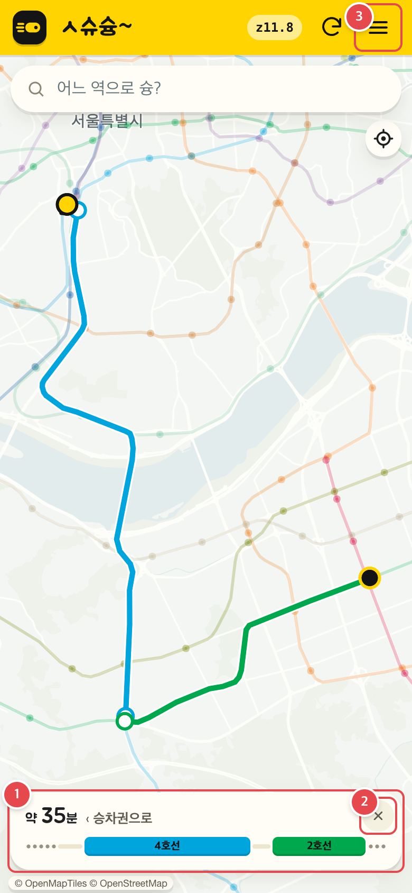
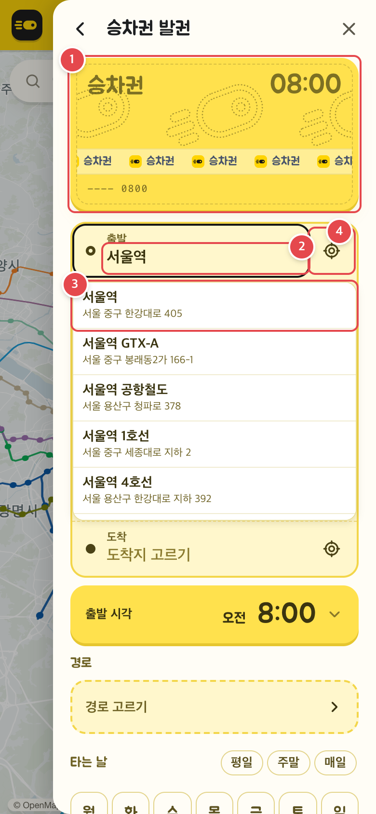
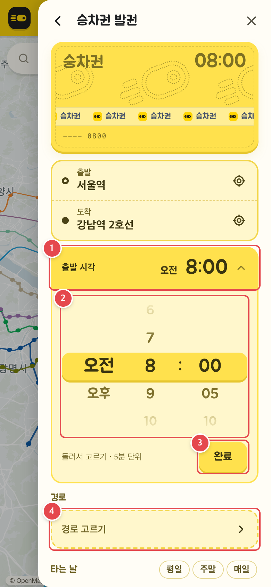
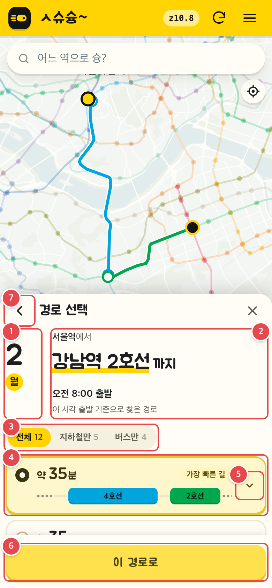
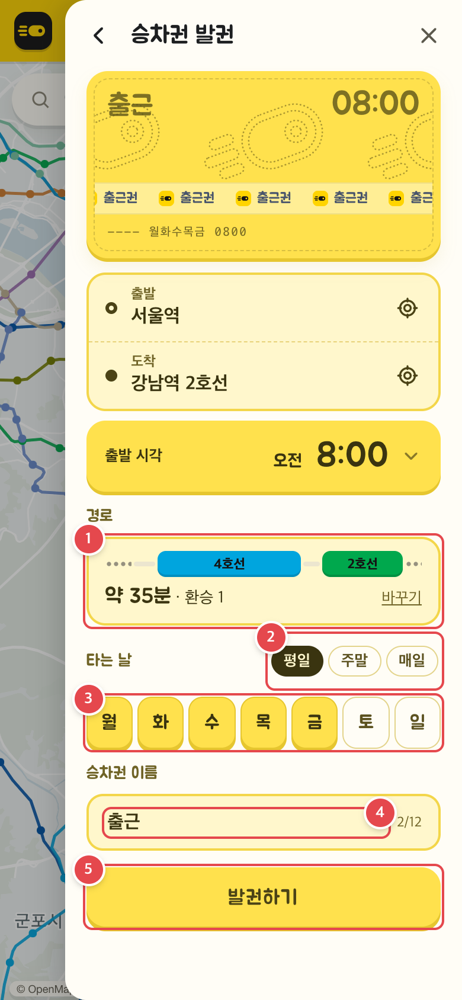
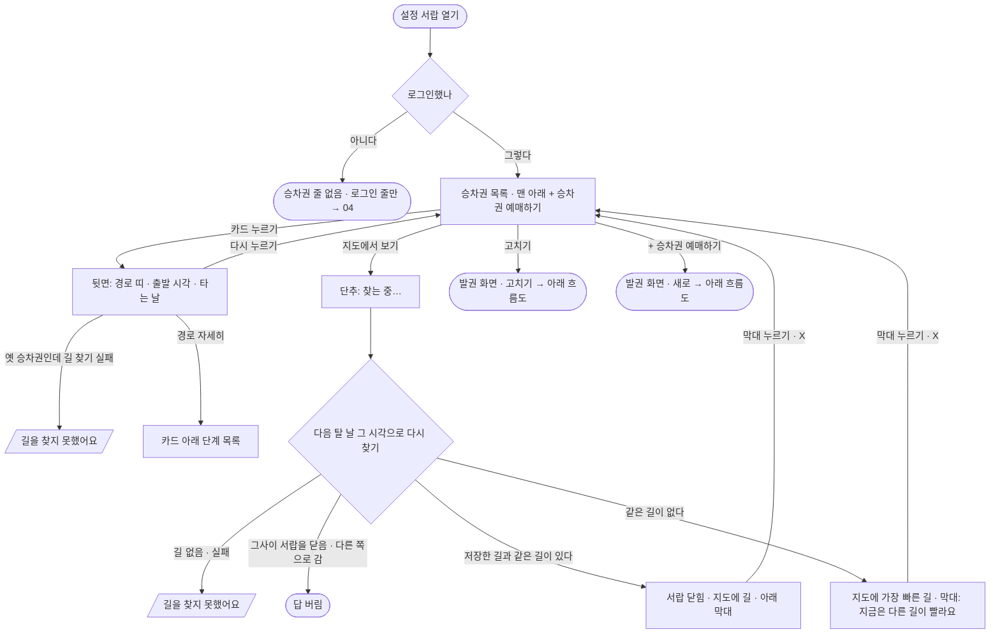
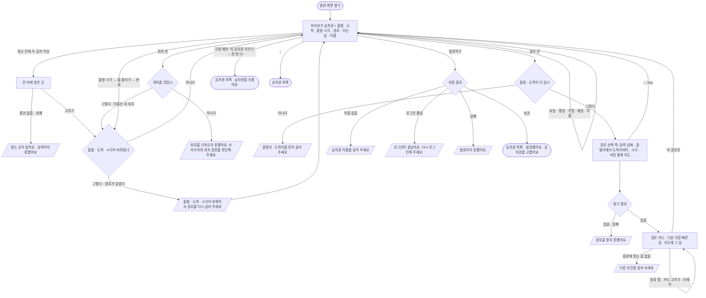

# 03 승차권 — 목록 · 뒤집기 · 지도에서 보기 · 발권 · 고치기

매일 타는 길을 「승차권」으로 저장해 두고(장소 · 출발 시각 · 경로 · 타는 날 · 이름), 목록에서 뒤집어 경로를 보거나 지도에 그려 보는 흐름. **로그인한 사람만** 쓴다. 모두 설정 서랍 안의 쪽(목록 `#menuTickets` → 발권 `#menuTicket` → 경로 선택 `#menuRoute`)에서 일어난다.

<!-- screens:start — tools/flows/capture.mjs 가 docs/flows/screens/ 의 JSON 으로 다시 쓴다. 손으로 고치지 말 것 -->
## 화면 기획

흐름 한 장 — 폰 폭(390px) 실제 화면을 고정 자료로 찍었다(2026-11-02 월 07:30 · 로그인한 사람 · 실시간 열차 없음).

### 1. 승차권 목록

설정 서랍 → 「승차권」 줄(로그인했을 때만 보인다). 승차권은 회원 코드를 받을 때(지도가 다 그려진 뒤 또는 메뉴 단추를 처음 누를 때) 받아 두고, 저장 · 지우기 뒤에 다시 받는다.

| 번호 | 무엇 | 누르면 | 예외 · 빈 상태 |
|---|---|---|---|
| 1 | 승차권 앞면 — 이름 · 출발 시각 · 일련번호(번호 · 요일 · 시각) | 카드를 누르면 뒤집혀 뒷면(2) | 승차권이 하나도 없으면 카드 없이 「+ 승차권 예매하기」만 |
| 2 | 「오늘」 — 오늘이 타는 날인 승차권 | — | 오늘이 타는 날이 아니면 없다 |
| 3 | 「+ 승차권 예매하기」 | 발권 화면(새로 — 출발 시각 08:00 · 타는 날 없음) | — |
| 4 | ‹ 뒤로 | 설정 서랍 메뉴 목록 | — |

### 2. 승차권 뒷면

목록에서 카드를 누른 화면. 다시 누르면 앞면으로 돌아간다.

| 번호 | 무엇 | 누르면 | 예외 · 빈 상태 |
|---|---|---|---|
| 1 | 경로 띠 — 출발지 → 갈아타는 곳 → 도착지 · 환승 N(없으면 「바로」) | — | 저장한 경로가 없는 옛 승차권은 다음 탈 날 그 시각으로 찾아 가장 빠른 길로 그린다 — 찾는 동안 출발 → 도착 이름만, 못 찾으면 「길을 찾지 못했어요」 |
| 2 | 「경로 자세히」 | 카드 아래에 단계 목록을 펼친다(다시 누르면 접기) | 저장한 경로가 있을 때만 보인다 |
| 3 | 출발 시각 | — | — |
| 4 | 타는 날 | — | 고른 요일이 없으면 「타는 날 없음」 |
| 5 | 「지도에서 보기」 | 다음 탈 날 그 시각으로 다시 찾아 지도에 길(3) | 찾는 동안 「찾는 중…」 · 길이 없으면 토스트 「길을 찾지 못했어요」(연결 실패는 「…연결을 확인해 주세요.」) |
| 6 | 「고치기 ›」 | 발권 화면(이 승차권 값으로 · 아래에 「이 승차권 지우기」) | — |

### 3. 지도에서 보기

뒷면의 「지도에서 보기」. 서랍이 닫히고 지도에 길 전체, 아래에 막대. 저장한 길과 같은 길이 있으면 그 길, 없으면 가장 빠른 길 + 「지금은 다른 길이 빨라요」.

| 번호 | 무엇 | 누르면 | 예외 · 빈 상태 |
|---|---|---|---|
| 1 | 아래 막대 — 약 N분 · 「‹ 승차권으로」 · 경로 띠 | 길을 지우고 서랍 · 승차권 목록 · 그 카드로 돌아간다 | 저장한 길과 같은 길이 없으면 「‹ 승차권으로 · 지금은 다른 길이 빨라요」 |
| 2 | ✕ | 막대 몸통과 같다(승차권 목록으로) | — |
| 3 | 메뉴 단추 | 서랍을 다시 열면 승차권 길과 막대를 지운다 | — |

### 4. 발권 — 장소 찾기

「+ 승차권 예매하기」로 연 발권 화면에서 출발 칸에 글자를 친 모습. 위쪽 미리보기 승차권이 고치는 대로 바뀐다.

| 번호 | 무엇 | 누르면 | 예외 · 빈 상태 |
|---|---|---|---|
| 1 | 미리보기 승차권 — 이름 · 출발 시각 · 타는 날이 고치는 대로 바뀐다 | — | — |
| 2 | 출발 칸 | 두 글자 이상 치면 0.3초 뒤 칸 바로 아래에 찾은 곳 | 찾은 곳이 없으면 「찾는 곳이 없어요」 · 실패하면 「검색하지 못했어요」 |
| 3 | 찾은 곳(이름 · 주소) | 칸에 넣고 도착 칸으로 초점이 간다 | 출발 · 도착이 바뀌면 고른 경로가 풀린다 — 토스트 「출발 · 도착 · 시각이 바뀌어서 경로를 다시 골라 주세요」 |
| 4 | 위치 핀(내 위치) | 본체가 아는 위치를, 없으면 한 번 물어 그 칸을 「내 위치」로 채운다 | 위치를 못 받으면 토스트 「위치를 가져오지 못했어요. 브라우저의 위치 권한을 확인해 주세요.」 |

### 5. 발권 — 출발 시각

출발 · 도착을 고른 뒤 「출발 시각」 칸을 눌러 휠을 연 모습.

| 번호 | 무엇 | 누르면 | 예외 · 빈 상태 |
|---|---|---|---|
| 1 | 출발 시각 칸 | 휠을 열고 닫는다 | — |
| 2 | 휠 — 오전 · 오후 / 시 / 분(5분 단위) | 돌리는 동안은 미리보기만 바뀐다 | — |
| 3 | 「완료」 | 휠을 접는다 | 시각이 바뀌었고 고른 경로가 있었으면 경로가 풀린다 — 토스트 「출발 · 도착 · 시각이 바뀌어서 경로를 다시 골라 주세요」 |
| 4 | 경로 칸(「경로 고르기」) | 경로 선택 쪽(5) | 출발 · 도착이 다 없으면 토스트 「출발지 · 도착지를 먼저 골라 주세요」 |

### 6. 경로 선택

발권 화면의 경로 칸을 누른 쪽. 서랍이 반쪽 시트로 내려가고 위 지도에 고른 카드의 길을 그린다. 같은 길 모양은 가장 빠른 것 하나로 묶는다.

| 번호 | 무엇 | 누르면 | 예외 · 빈 상태 |
|---|---|---|---|
| 1 | 달력 날짜 — 찾은 날 | — | 고른 요일 중 가장 가까운 날 · 요일이 없으면 오늘 · 그 시각이 지났으면 다음 날 |
| 2 | 「출발지에서 → 도착지까지」 · 「오전 HH:MM 출발 · 이 시각 출발 기준으로 찾은 경로」 | — | — |
| 3 | 종류 탭(길 수) | 받은 길을 다시 나눈다(다시 찾지 않는다) | 맞는 길이 없으면 「다른 조건을 골라 보세요」 |
| 4 | 고른 경로 카드 — 약 N분 · 꼬리표 · 경로 띠 | 그 카드를 고르고 지도에 그 길 | 처음에는 저장한 경로(고칠 때) 또는 「가장 빠른 길」 · 찾는 동안 「경로를 찾고 있어요」 + 뼈대 카드 · 없으면 서버가 준 이유 또는 「경로를 찾지 못했어요.」 |
| 5 | 자세히(⌄) | 카드 아래에 환승 · 걷기와 단계 목록 | — |
| 6 | 「이 경로로」 | 발권 화면으로 돌아가 경로 칸에 「약 N분 · 환승 N」(6) | — |
| 7 | ‹ 뒤로 | 발권 화면(Esc 도 같다 — 서랍을 닫지 않는다) | — |

### 7. 발권 — 저장

경로를 고르고 타는 날 · 이름을 넣은 발권 화면 아래쪽.

| 번호 | 무엇 | 누르면 | 예외 · 빈 상태 |
|---|---|---|---|
| 1 | 경로 칸 — 고른 길의 띠 · 약 N분 · 환승 N | 「바꾸기」 — 경로 선택(5)으로 다시 | — |
| 2 | 평일 · 주말 · 매일 | 요일을 한 번에 고른다 | — |
| 3 | 요일 단추(월 … 일) | 누를 때마다 넣고 빼기 | 하나도 안 골라도 저장된다(뒷면 「타는 날 없음」 — 확인 필요) |
| 4 | 승차권 이름(12자까지 · 오른쪽 글자 수) | — | — |
| 5 | 「발권하기」 | 「발권하는 중…」 → 승차권 목록 + 토스트 「발권했어요」(고칠 때 「승차권을 고쳤어요」) | 경로를 고르기 전에는 꺼져 있다 · 이름이 없으면 「승차권 이름을 넣어 주세요」 · 로그인이 풀리면 「로그인이 끝났어요. 다시 로그인해 주세요.」 · 실패하면 서버가 준 글 또는 「발권하지 못했어요.」 |

<!-- screens:end -->

## 시작점
- 설정 서랍 목록의 「승차권」 줄(`#ticketsRow`) — 로그인했을 때만 보인다

## 흐름도 — 목록 · 뒤집기 · 지도에서 보기

## 흐름도 — 발권 · 고치기

## 단계
1. **목록** — 회원 코드를 받을 때(지도가 다 그려진 뒤 또는 메뉴 단추를 처음 누를 때) 로그인한 상태면 승차권을 받아 둔다(저장 · 지우기 뒤에도 다시 받는다). 카드 앞면: 이름 · 출발 시각 · 일련번호(번호 · 요일 · 시각) · 오늘 타는 날이면 「오늘」. 맨 아래 「+ 승차권 예매하기」.
2. **뒤집기** — 카드를 누르면 뒷면. 저장한 경로가 있으면 그 경로 띠, 없으면(옛 승차권) 다음 탈 날 그 시각으로 찾아 가장 빠른 길을 띠로 그린다. 「경로 자세히」로 단계 목록을 펼친다.
3. **지도에서 보기** — 뒷면의 단추. 저장한 경로에는 지도에 그릴 길 모양이 없어 다음 탈 날 그 시각으로 다시 찾는다. 같은 길이 있으면 그 길, 없으면 가장 빠른 길 + 「지금은 다른 길이 빨라요」. 서랍이 닫히고 지도에 길, 아래 막대(「‹ 승차권으로」). 막대 · ✕ 를 누르면 서랍 · 목록 · 그 카드로 돌아온다.
4. **발권 화면 열기** — 「+ 승차권 예매하기」(새로 · 출발 시각 08:00 · 타는 날 없음) 또는 「고치기 ›」(그 승차권 값). 위쪽 미리보기 승차권이 고치는 대로 바뀐다.
5. **장소** — 출발 · 도착 칸에 두 글자 이상 치면 0.3초 뒤 칸 아래 목록. 출발을 고르면 도착 칸으로 초점이 간다. 위치 핀은 본체가 아는 위치를, 없으면 한 번 물어 그 칸을 「내 위치」로 채운다.
6. **출발 시각** — 휠(오전 · 오후 / 시 / 분 5분 단위)을 돌리고 「완료」. 돌리는 동안은 미리보기만 바뀌고, 접을 때 시각이 바뀌었으면 고른 경로를 푼다.
7. **경로 선택** — 「경로」 칸을 누르면 경로 선택 쪽으로 간다. 머리말은 달력 날짜(고른 요일 중 가장 가까운 날 — 없으면 오늘, 시각이 지났으면 다음 날) · 「출발지에서 → 도착지까지」 · 「오전 HH:MM 출발 · 이 시각 출발 기준으로 찾은 경로」. 같은 길 모양은 가장 빠른 것 하나로 묶고, 처음에는 저장한 경로(고칠 때) 또는 「가장 빠른 길」이 골라져 있다. 서랍이 지도 옆(휴대폰은 반쪽 시트)으로 비켜 고른 카드의 길을 지도에 그린다. 종류 탭은 받은 길을 다시 나눌 뿐 다시 찾지 않는다. 「이 경로로」를 누르면 발권 화면으로 돌아가 경로 칸에 「약 N분 · 환승 N」.
8. **타는 날 · 이름** — 요일 단추와 「평일 · 주말 · 매일」. 이름은 12자까지.
9. **저장** — 경로를 고르기 전에는 「발권하기」가 꺼져 있다. 누르면 「발권하는 중…」 → 성공하면 목록으로 가서 「발권했어요」(고칠 때 「승차권을 고쳤어요」).
10. **지우기** — 고칠 때만 「이 승차권 지우기」. 한 번 누르면 「한 번 더 누르면 지워요」, 또 누르면 지우고 목록으로 「승차권을 지웠어요」.

## 갈림길
| 갈림길 | 동작 · 문구 |
|---|---|
| 로그인 안 됨 | 서랍에 「승차권」 줄이 없다(→ [04](04-account.md) 로그인). 저장 · 지우기 중 로그인이 풀리면(401) 「로그인이 끝났어요. 다시 로그인해 주세요.」 · 회원 줄이 로그인 줄로 바뀐다 |
| 불러오는 중 | 뒷면 경로 띠: 찾는 동안 「출발 → 도착」 이름만 / 지도에서 보기 단추 「찾는 중…」 / 경로 선택 「경로를 찾고 있어요」 + 뼈대 카드 / 저장 「발권하는 중…」 |
| 경로 없음 | 경로 선택: 서버가 준 이유 또는 「경로를 찾지 못했어요.」, 연결 실패 「경로를 찾지 못했어요. 연결을 확인해 주세요.」 / 종류 탭에 맞는 길 없음 「다른 조건을 골라 보세요」 / 지도에서 보기 「길을 찾지 못했어요」(연결 실패는 「…연결을 확인해 주세요.」) / 뒷면 「길을 찾지 못했어요」 |
| 위치 권한 없음 | 위치 핀: 「위치를 가져오지 못했어요. 브라우저의 위치 권한을 확인해 주세요.」 |
| 경로가 풀림 | 출발 · 도착 · 시각이 바뀌면 「출발 · 도착 · 시각이 바뀌어서 경로를 다시 골라 주세요」 |
| 빠진 칸 | 「출발지 · 도착지를 먼저 골라 주세요」(경로 칸) · 「출발지 · 도착지를 골라 주세요」 · 「경로를 골라 주세요」 · 「승차권 이름을 넣어 주세요」 |
| 저장 · 지우기 실패 | 서버가 준 글 또는 「발권하지 못했어요.」 · 「지우지 못했어요.」(연결 실패는 「…연결을 확인해 주세요.」) |
| 실시간 자료 끊김 | 해당 없음(승차권 경로는 `/api/route` 로 찾는다) |

## 끝점
- 저장 · 지우기 성공 → 승차권 목록 + 토스트
- 지도에서 보기 → 지도 + 아래 막대 → 막대를 누르면 목록으로
- 서랍 닫기(✕ · Esc · 바깥 누르기) — 찾던 답은 버린다. 경로 선택 쪽의 Esc 는 서랍을 닫지 않고 발권 화면으로
- 다른 길(길찾기 · 버스 노선)이 지도를 차지하면 승차권 길 · 막대를 치운다

## 관련 코드
| 무엇 | 경로:줄 |
|---|---|
| 서랍의 승차권 줄 · 세 쪽 | `web/index.html:63` · `web/user/tickets_view.tsx:210`(쪽 목록 `PAGES`) |
| 목록 받기 · 그리기 · 뒤집기 · 뒷면 경로 | `web/user/account.mts:365-383` · `web/user/account.mts:839` · `web/user/account.mts:117-133` |
| 카드 앞 · 뒷면 · 목록 쪽 | `web/user/tickets_view.tsx:80-113` |
| ‹ 차례(경로 → 발권 → 목록) | `web/user/account.mts:385-389` |
| 요일 · 경로 풀림 | `web/user/account.mts:395-407` |
| 장소 찾기 · 고르기 · 위치 핀 | `web/user/account.mts:410-481` |
| 출발 시각 휠 | `web/user/account.mts:482-540` |
| 경로 찾기 · 고르기 · 종류 탭 | `web/user/account.mts:542-597` |
| 경로 선택 쪽 지도 · Esc | `web/user/account.mts:599-633` |
| 지도에서 보기 · 아래 막대 | `web/user/account.mts:634-707` |
| 발권 화면 열기 · 저장 · 지우기 | `web/user/account.mts:709-748` |
| 발권 화면 · 경로 선택 쪽 그리기 | `web/user/tickets_view.tsx:144-207` |
| 지도에 그리기(본체 쪽 — 길찾기 경로를 놓게 함) | `web/maplibre_runtime.mts:597` |
| 같은 길 묶기 · 다음 탈 날 · 종류 탭 셈 | `web/user/ticket_routes.mts` |

## 확인 필요
- **타는 날 없이 저장된다** — 새 승차권은 타는 날이 비어 있고, 저장 때 요일을 검사하지 않는다(서버도 빈 목록을 받는다 `server/services/members.py:212-216`). 뒷면에는 「타는 날 없음」으로 보인다. 요일을 꼭 고르게 할지 정책 확인 필요
- `web/user/account.mts:627` 주석에 「경유지 목록이 펼쳐져 있으면 목록이 먼저」가 남아 있다 — 경유지는 #127 에서 빠졌고 코드가 보는 것은 장소 목록(`placeFor`)이다. 주석만 옛 글로 보인다(동작 영향 없음 · 고치지 않음)
- 서버의 발권 본문에는 아직 `via`(경유지) 칸이 있다(`server/services/members.py:200` · `server/routes/members.py:17`) — 웹은 보내지 않는다. 서버 쪽에서 남겨 둘지는 syung-be 확인 필요
