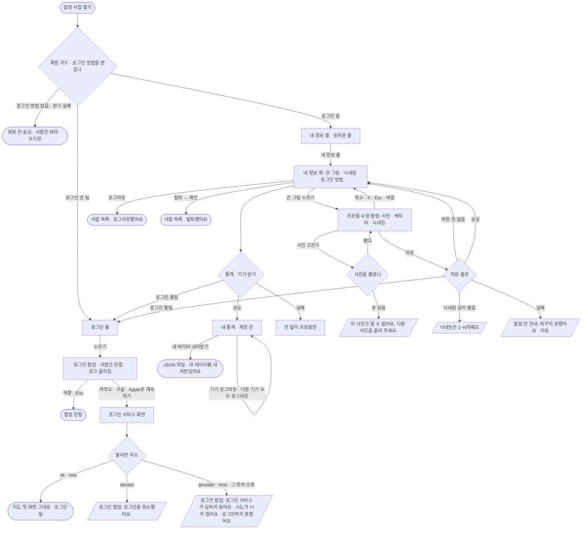

# 04 로그인 · 내 정보 · 프로필 수정

설정 서랍에서 로그인하고(카카오 · 구글 · Apple), 내 정보 쪽에서 통계 · 로그인 기기를 보고, 프로필(사진 · 캐릭터 · 닉네임)을 고치고, 로그아웃 · 탈퇴하는 흐름.

## 시작점
- 설정 서랍 목록의 「로그인」 줄(`#loginOpen`) — 로그인 안 됐을 때
- 설정 서랍 목록의 내 정보 줄(`#accountRow` — 내 그림 · 닉네임) — 로그인했을 때
- 로그인 서비스에서 돌아온 주소 `#login=ok | new | <오류>`

## 흐름도

## 단계
1. **회원 칸 준비** — 회원 코드를 받으면 로그인 방법과 지금 로그인한 사람을 한 번에 묻는다(`/api/auth/providers`). 로그인 방법이 없으면 아무것도 보이지 않는다. 로그인 안 됐으면 「로그인」 줄, 됐으면 내 정보 줄 + 「승차권」 줄.
2. **로그인 팝업** — 「로그인」 줄을 누르면 서랍이 닫히고 화면 전체 위에 팝업이 뜬다. 로고 움직임(새싹 캐릭터가 열차에 타고 출발 · 동작 줄이기면 정지 로고)과 「카카오로 계속하기」 · 「구글로 계속하기」 · 「Apple로 계속하기」(서버가 켠 방법만), 개인정보처리방침 링크.
3. **로그인 서비스 → 돌아옴** — 서비스 화면에서 돌아오면 주소의 `#login=…` 을 지운다. 성공(`ok` · `new`)이면 서랍 · 팝업을 열지 않고 지도 첫 화면 그대로 둔다. 실패면 로그인 팝업을 다시 띄우고 안내를 넣는다(이미 로그인돼 있으면 서랍 목록만 연다).
4. **내 정보 쪽** — 내 정보 줄을 누를 때마다 통계 · 로그인 기기를 받는다. 내 통계: 함께한 날 · 승차권 수 · 한 주에 타는 횟수 · 최근 N일 슝 연 날 · 길찾기 · 날짜별 사용 · 이번 달 예상 교통비. 계정: 「로그인한 기기 N대」(기기마다 「로그아웃」 · 「이 기기」 표시) · 「다른 기기 모두 로그아웃」 · 「내 데이터 내려받기」. 맨 아래 개인정보처리방침 · 「로그아웃」 · 「탈퇴」.
5. **프로필 수정** — 큰 그림(「프로필 수정」)을 누르면 서랍 위에 팝업. 사진(가운데를 정사각형으로 잘라 256 크기로 줄여 올린다 · 「위치 같은 사진 정보는 빼요」) 또는 캐릭터를 고르고 닉네임을 고친다. 「저장」은 바뀐 것만 사진 → 닉네임 차례로 보낸다. 사진이 실패하면 닉네임은 보내지 않는다.
6. **로그아웃 · 탈퇴** — 로그아웃은 바로 서랍 목록으로 「로그아웃했어요」. 탈퇴는 「탈퇴하면 승차권까지 모두 지워져요」 확인 뒤 「탈퇴했어요」.
7. **사용 횟수** — 로그인한 동안 앱 열기 · 길찾기 · 승차권 뒤집기를 센다(못 보내도 화면에는 아무 일 없다).

## 갈림길
| 갈림길 | 동작 · 문구 |
|---|---|
| 로그인 안 됨 | 「로그인」 줄만 보인다 · 내 정보 · 승차권 줄 없음. 쓰던 중 로그인이 풀리면(401) 「로그인이 끝났어요. 다시 로그인해 주세요.」 · 줄이 로그인 줄로 바뀐다(사진만 저장된 뒤면 「프로필 사진은 바꿨어요. 닉네임은 다시 로그인한 뒤 바꿔 주세요.」) |
| 로그인 실패 | 팝업 안 안내 — `denied` 「로그인을 취소했어요.」(오류 모양 아님) · `provider` 「로그인 서비스가 답하지 않아요. 잠시 뒤 다시 해 주세요.」 · `limit` 「시도가 너무 많아요. 10분 뒤 다시 해 주세요.」 · 그 밖 「로그인하지 못했어요. 잠시 뒤 다시 해 주세요.」 |
| 회원 기능 꺼짐 | 로그인 방법이 없거나 받기 실패 → 회원 칸 전체 숨김(안내 없음) |
| 불러오는 중 | 통계 · 계정 칸은 받을 때까지 숨어 있다 / 사진을 줄이는 동안 「저장」이 막힌다 / 저장 중에는 취소 · 닫기가 듣지 않는다 |
| 저장 실패 | 「프로필 사진을 바꾸지 못했어요. {이유}」 · 「닉네임을 바꾸지 못했어요. {이유}」 · 「프로필 사진은 바꿨지만 닉네임을 바꾸지 못했어요. {이유}」 · 연결 실패 「바꾸지 못했어요. 연결을 확인해 주세요.」 |
| 기기 · 내보내기 · 탈퇴 실패 | 「로그아웃하지 못했어요.」 · 「내려받지 못했어요. 잠시 뒤 다시 해 주세요.」 · 「탈퇴하지 못했어요. 잠시 뒤 다시 해 주세요.」(연결 실패는 「…연결을 확인해 주세요.」) |
| 경로 없음 · 위치 권한 없음 · 실시간 자료 끊김 | 해당 없음 |

## 끝점
- 로그인 성공 → 지도 첫 화면(로그인 됨)
- 프로필 저장 · 취소 → 내 정보 쪽(초점은 큰 그림으로)
- 로그아웃 · 탈퇴 → 서랍 목록(로그인 줄) + 토스트
- 내려받기 → `syung-my-data-YYYYMMDD.json`

## 관련 코드
| 무엇 | 경로:줄 |
|---|---|
| 서랍의 회원 줄 · 로그인 팝업 · 프로필 팝업 껍데기 | `web/index.html:63` · `web/index.html:77-79` |
| 회원 코드 늦게 받기(`login=` 이면 바로) | `web/maplibre_runtime.mts:935-939` |
| 로그인 방법 · 지금 로그인한 사람 받기 | `web/user/account.mts:136-146` |
| 로그인 오류 문구 · 로그인 방법 단추 | `web/user/account.mts:42-46` · `web/user/account.mts:50` · `web/user/account.mts:147-152` |
| 로그인 팝업 열기 · 닫기 · Esc · Tab | `web/user/account.mts:214-242` |
| 줄 보이기(로그인 됨 · 안 됨) | `web/user/account.mts:245-253` |
| 프로필 수정(열기 · 닫기 · 사진 · 캐릭터 · 저장) | `web/user/account.mts:254-363` |
| 사용 횟수 | `web/user/account.mts:759-763` |
| 내 정보 받기 · 기기 로그아웃 · 내려받기 | `web/user/account.mts:766-815` |
| 로그아웃 · 탈퇴 | `web/user/account.mts:817-828` |
| 로그인에서 돌아옴 | `web/user/account.mts:841-849` |
| 내 정보 쪽 · 프로필 팝업 몸통 그리기 | `web/user/account_view.tsx:79-150` |

## 확인 필요
- 로그인 성공(`#login=ok` · `new`)으로 돌아왔을 때 안내(토스트 등)가 없다 — 서랍의 줄이 바뀐 것 말고는 알림이 없다. 코드 주석은 의도로 적혀 있다(`web/user/account.mts:841-842`). 처음 가입(`new`)도 같은 화면인지 정책 확인 필요
