# 06 검색 합치기

위쪽 역 검색창을 없애고 입구를 「어디로 갈까요?」 하나로 합친 흐름이다. 역과 장소를 한 목록에서 찾고, 고른 곳에서 출발 · 도착을 정한다.

화면 그림은 실제 지도에서 찍었다(390×844). 스토리북은 같은 부품을 쓴다 — `화면 흐름/06 검색 합치기 화면` · 부품 `컴포넌트/장소 검색` · 마커 `컴포넌트/슝 마커`. 이어지는 동작은 [01](01-map-search-station.md) · [02](02-journey.md) · [03](03-tickets.md).

## 시작점
- 지도 위 단추 「어디로 갈까요?」 하나

## 흐름도
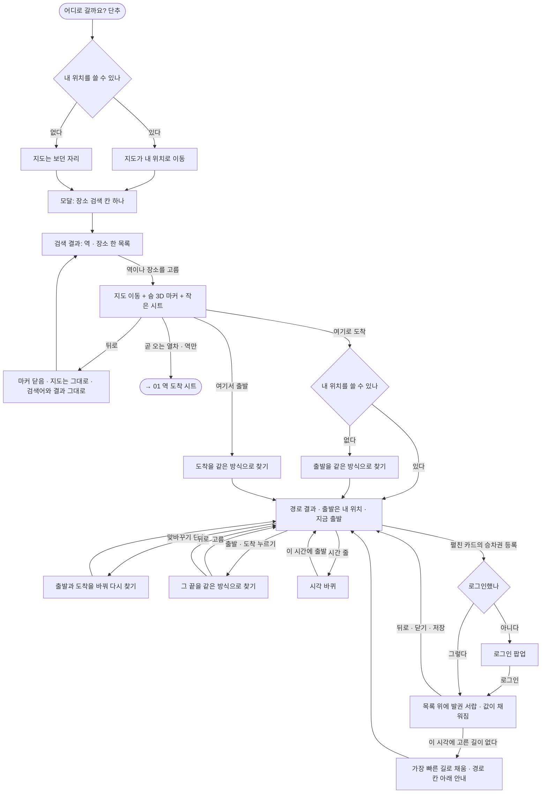

## 단계
### 1. 지도 첫 화면
위쪽 검색창이 없고 입구는 「어디로 갈까요?」 하나다.

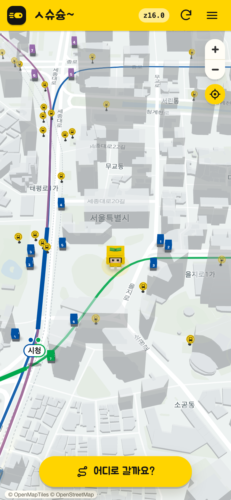

### 2. 모달 열기
아래 시트(모달)로 열리고 초점이 칸에 간다. 지도는 내 위치로 간다. 칸은 「장소 검색」 하나다. 찾은 곳을 고르는 일까지 이 모달 안에서 한다.

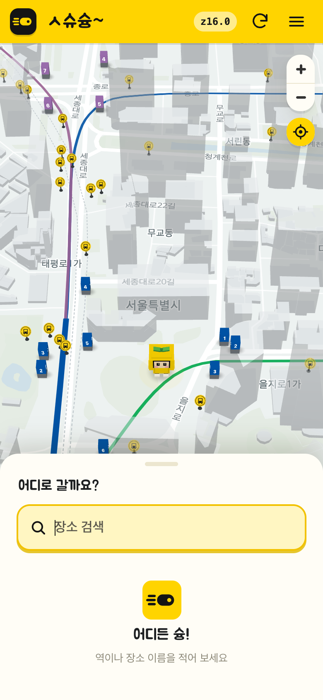

### 3. 검색 결과
역과 장소를 나누지 않고 한 목록으로 보여 준다. 역을 먼저, 그 뒤에 장소를 둔다. 역은 노란 열차 칸과 노선 칩, 장소는 핀 칸과 주소로 구분한다. 역은 치는 대로 나오고, 장소는 두 글자부터 0.3초 뒤에 붙는다.

카카오 결과 중 역 자체인 것은 이름과 거리로 걸러 낸다. 역 이름 뒤에 남는 말을 낱말로 나눠, 모두 그 역의 노선이거나 철도 이름(공항철도 · KTX · SRT · ITX · GTX-A · 경부선 · 경의선 · 분당선 · 수인선 · 중앙선 등 — `web/lib/place-search.mts` `RAILWAY_NAMES`)일 때만 역 자체로 본다. 「강남역 2호선」 · 「서울역 공항철도」 · 「서울역 KTX」는 빠지고, 「강남역 스타벅스」 · 「강남역 어선」처럼 다른 곳은 남는다. 그 역에 없는 노선을 붙인 「강남역 3호선」도 남는다.

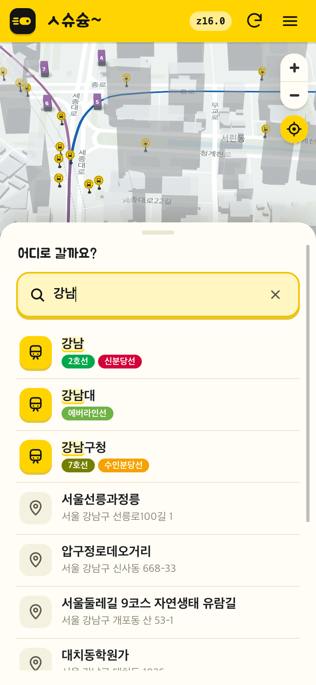

### 4. 역을 고름
지도가 그 역으로 가고 슝 3D 마커가 선다. 작은 시트는 이름 · 노선 칩(주소 없음) · 「곧 오는 열차」 · 여기서 출발 · 여기로 도착을 보여 준다. 「곧 오는 열차」를 누르면 역 도착 시트를 연다.

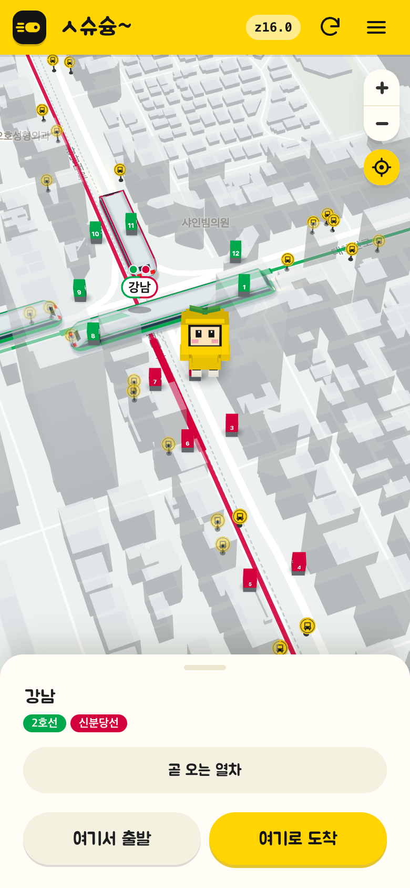

### 5. 장소를 고름
역과 같은 작은 시트이고, 노선 칩 대신 주소를 보여 주며 「곧 오는 열차」는 없다.

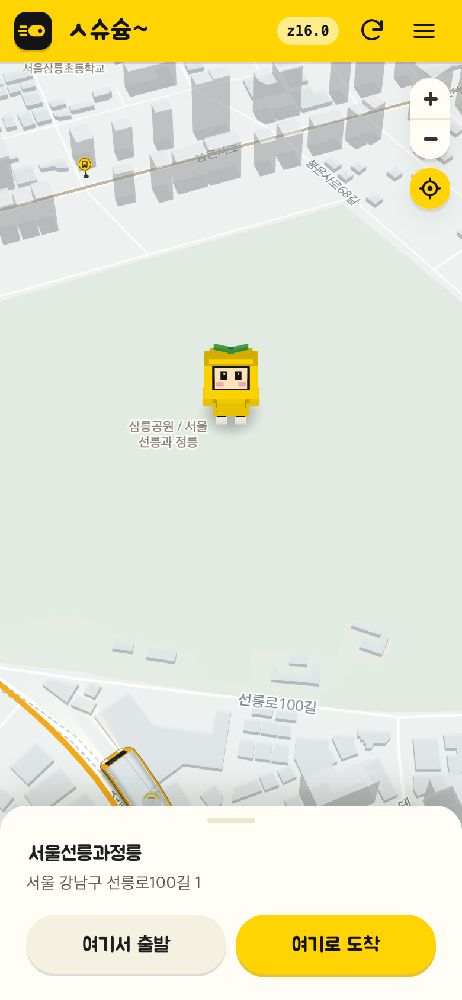

### 슝 3D 마커
지도에 쓰는 슝 모델을 어느 모드든 기본 모습으로 1.5배 크기로 세운다. 지도를 좌우로 돌리면 몸 전체가 돌아 늘 카메라를 보고, 기울이면 고개만 위아래로 움직인다. 멈춘 지도를 다시 그리게 하지 않는다. 스토리 `컴포넌트/슝 마커` 에서 직접 돌려 볼 수 있다.

### 6. 뒤로 가기
마커와 작은 시트를 닫고, 모달에 검색어와 결과 목록을 그대로 다시 보여 준다. 지도는 고른 곳에 그대로 둔다.

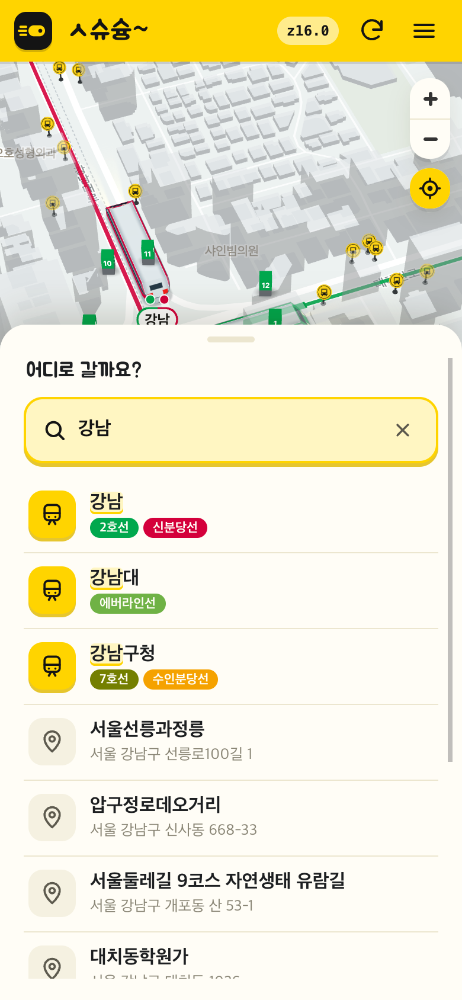

### 7. 도착을 고름 → 경로 결과
내 위치를 출발로 바로 경로를 보여 준다. 시각은 묻지 않고 지금 출발로 찾으며, 출발 · 도착 · 시간 세 줄을 카드 하나에 묶는다. 요약의 출발이나 도착을 누르면 그 끝을 장소 검색으로 바꾸고, 뒤로 가면 결과로 돌아온다. 요약 줄의 맞바꾸기 단추(⇅)는 출발과 도착을 바꿔 다시 찾는다. 두 번 누르면 원래대로 돌아온다. 휴대폰에서 시트는 처음 50%이고 손잡이를 위로 끌 때만 72%로 커진다.

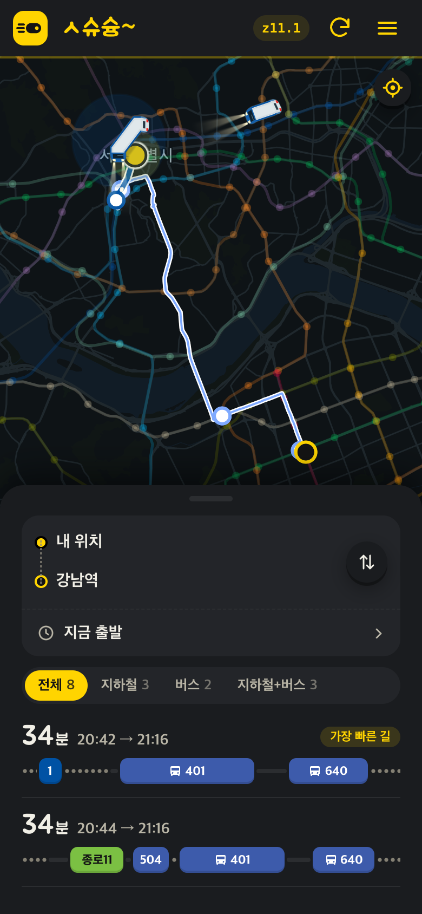

### 8. 출발 시각 고르기
시간 줄을 누르면 발권 화면과 같은 시각 바퀴(오전 · 오후 / 시 / 5분 단위 분)가 열린다. 날짜는 고르지 않고 오늘 기준이다. 「지금으로」 로 되돌리고, 지난 시각에서 멈추면 고를 수 있는 가장 이른 때로 되돌린다.

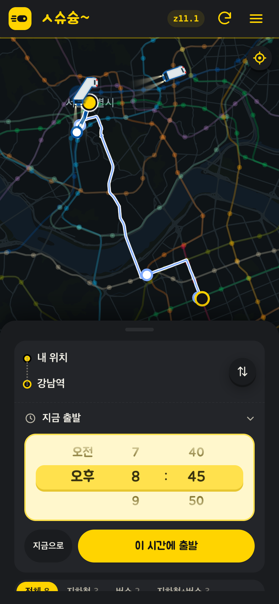

### 9. 승차권 등록
경로 카드를 눌러 펼치면 맨 아래에 「승차권 등록」이 있다. 로그인 전이면 「로그인하면 승차권을 등록할 수 있어요」 팝업을 먼저 띄우고, 로그인하면 지도가 뜬 뒤(최대 15초 기다림) 경로 목록을 되살리고 발권 서랍으로 이어진다. 지도가 끝내 뜨지 않거나 경로를 다시 그리지 못해도 발권 서랍은 열린다.

내 위치를 잃어 출발이 없으면 단추 바로 위에 「내 위치를 찾지 못했어요. 위에서 출발을 다시 골라 주세요.」를 보인다.

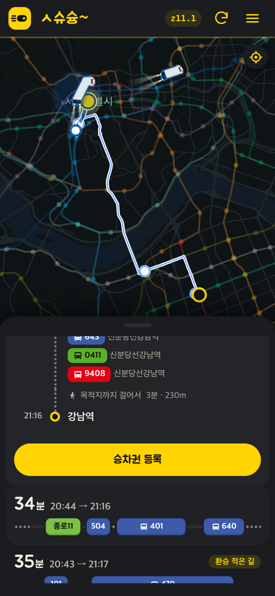

### 10. 발권 화면
경로 목록을 닫지 않고 그 위에 발권 서랍을 연다. 출발 · 도착 · 시각 · 고른 경로가 채워져 있다. 시각은 경로의 출발 시각에서 가장 가까운 5분이고(오늘 경로인데 그 시각이 지났으면 지금 기준 다음 5분 — 출발 17:42 를 17:42 에 누르면 17:45, 17:50 에 누르면 17:55. 자정을 넘긴 시각으로 찾은 경로는 올리지 않는다), 그 시각으로 경로를 다시 찾아 채운다(경로는 조금 늦게 채워진다). 칸 차례는 승차권 이름 → 타는 날 → 출발 · 도착 → 출발 시각 → 경로이고, 이름 · 타는 날은 사람이 넣는다.

| 다시 찾은 답 | 경로 칸 |
|---|---|
| 고른 카드와 같은 길 모양(노선 + 타고 내린 역)이 있다 | 그 길 |
| 같은 길 모양이 없다 | 가장 빠른 길 · 경로 칸 아래에 「이 시각에는 고른 길이 없어 가장 빠른 길로 채웠어요」 |
| 경로가 없다 | 비어 있음 · 토스트 「경로를 찾지 못했어요. 경로를 골라 주세요」 |
| 연결 실패 | 비어 있음 · 토스트 「경로를 찾지 못했어요. 연결을 확인해 주세요.」 |

서랍을 닫으면(뒤로 · ✕ · Esc · 바깥 누름 · 저장 뒤 모두) 경로 목록이 펼친 카드와 스크롤까지 그대로 보이고, 초점은 「승차권 등록」으로 돌아온다.

발권 화면의 「경로 고르기」는 지도와 시트 자리를 잠시 차지한다. ‹ 로 발권 화면에 돌아오고, 서랍을 닫으면 경로 목록이 펼친 카드까지 그대로 돌아온다.

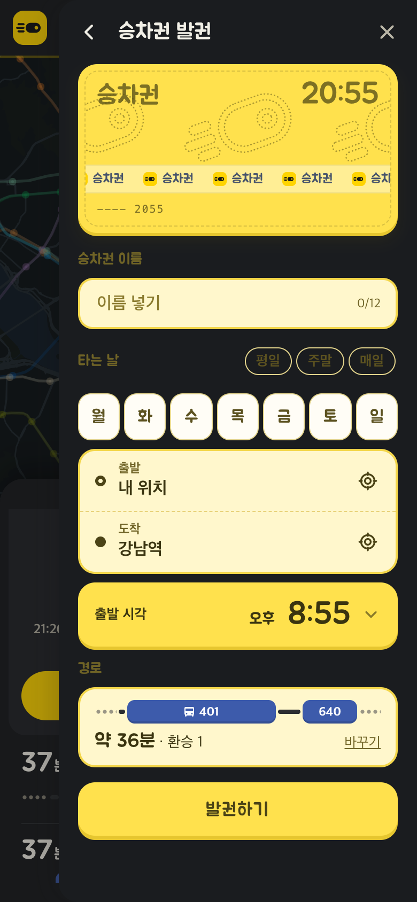

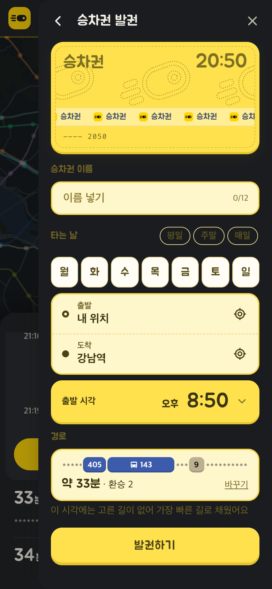

### 11. 출발을 고름 → 도착 찾기
고른 곳이 출발이 되고, 도착을 같은 방식으로 찾는다. 마커는 그대로 둔다.

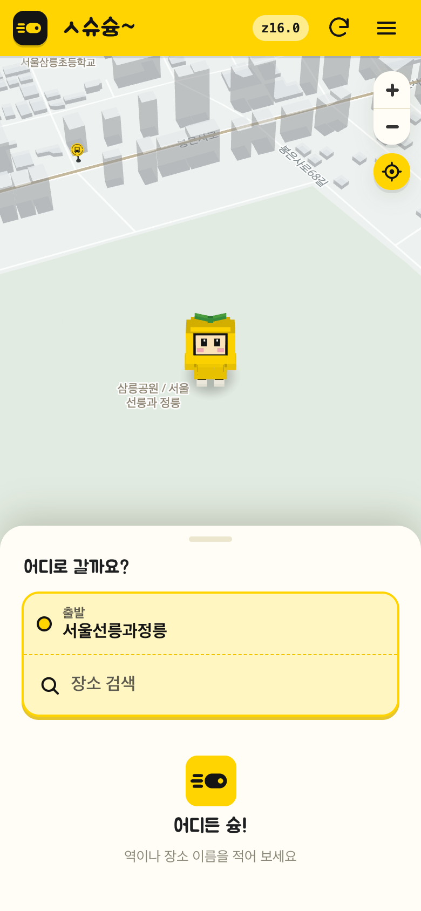

## 갈림길
### 내 위치를 못 쓸 때
지도를 보던 자리에 두고, 도착을 고르면 출발을 같은 방식으로 찾는다. 도착을 고른 뒤 지도는 도착지에 머문다.

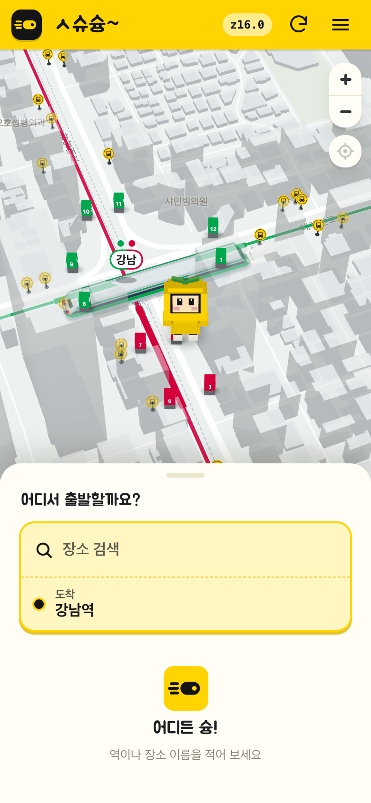

### 그 밖
| 갈림길 | 동작 |
|---|---|
| 불러오는 중 | 역은 바로 나오고 장소는 늦게 붙는다. 경로는 「경로를 찾고 있어요」 + 뼈대 카드 |
| 장소 검색 실패 · 결과 없음 | 역 결과는 그대로 두고, 없으면 목록 자리에 안내 |
| 로그인 안 됨 | 승차권 등록에서만 로그인 팝업. 검색 · 경로는 로그인 없이 쓴다 |
| 경로 없음 | [02](02-journey.md) 그대로 |
| 실시간 자료 끊김 | 해당 없음 — 지도 위 띠는 [01](01-map-search-station.md) 그대로 |

## 끝점
- 경로 결과(지도에 경로 · 시트에 경로 카드)
- 역 도착 시트(「곧 오는 열차」)
- 발권 서랍 — 닫으면 경로 결과로 돌아온다

## 재는 것
출발 · 도착을 고른 횟수를 GA4 이벤트로 잰다. 어느 쪽인지만 보내고 장소는 보내지 않는다(`web/lib/analytics.mts`).

## 관련 코드
- 슝 마커: `web/map/avatar.mts` · `web/map/overlay.mts`
- 장소 검색 셈(역 찾기 · 합치기 · 가까운 5분): `web/lib/place-search.mts` · 시험 `tests/place_search.test.mjs`
- 장소 검색 화면: `web/components/place_search.tsx`
- 길찾기 시트: `web/lib/journey-ui.mts` · `web/ui/journey_sheet.tsx` · `web/components/journey_summary.tsx`
- 역 도착 시트: `web/components/station_sheet.tsx` · `web/ui/sheet.mts`
- 시각 고르기: `web/components/journey_when.tsx` · `web/components/time_field.tsx` · `web/lib/time-wheel.mts`
- 승차권 등록 단추: `web/components/route_card.tsx`
- 발권 화면 · 닫으면 돌아오기: `web/components/ticket_form.tsx` · `web/user/account.mts` `openFromJourney` · `closeToJourney`

## 확인 필요
- 고른 곳의 슝 마커와 내 위치 캐릭터가 같은 모습이다. 마커를 1.5배로 키워 구분한다 — 실기기에서 충분히 구분되는지
- 발권 화면의 「지도에서 보기」는 승차권 목록에서만 쓸 수 있다. 길찾기에서 온 흐름은 저장 뒤 목록을 거치지 않아 겹치지 않는다. 따로 쓰면 기존대로 길찾기 경로를 놓는다([02](02-journey.md) 끝점)
