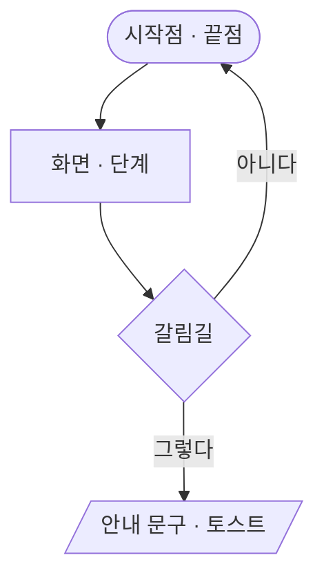

# 슝 화면 흐름

웹(`web/`)에서 사람이 지나가는 화면 흐름을 그린 기획 문서다. **지금 main 코드에 있는 흐름만** 적는다(기준 main `bff391f` · #129 까지). 새 기능 기획이 아니라 지금 동작의 지도다 — 코드가 바뀌면 이 문서도 같이 고친다.

## 목차
| 문서 | 흐름 |
|---|---|
| [01-map-search-station.md](01-map-search-station.md) | 처음 열기 → 지도 · 실시간 열차 → 역 검색 · 역 누르기 → 역 정보(도착 시트) · 열차 시트 |
| [02-journey.md](02-journey.md) | 길찾기: 출발 · 도착 → 경로 고르기 → 단계 보기 → 지도에서 보기 → 다시 보기 막대 |
| [03-tickets.md](03-tickets.md) | 승차권: 목록 · 뒤집기 · 지도에서 보기 / 발권 · 고치기(장소 → 시각 → 경로 선택 → 타는 날 · 이름 → 저장) · 지우기 |
| [04-account.md](04-account.md) | 로그인 · 로그인에서 돌아옴 · 내 정보(통계 · 기기) · 프로필 수정 · 로그아웃 · 탈퇴 |
| [05-settings-modes.md](05-settings-modes.md) | 설정 서랍: 테마 · 도시 모드 바꾸기 · 성능 · 배터리 · 데이터 출처 · 새로고침 |

## 문서 하나의 모양
1. **시작점** — 사람이 이 흐름에 들어오는 곳(단추 · 주소 · 다른 흐름)
2. **흐름도** — Mermaid `flowchart`(GitHub 에서 그림으로 보인다)
3. **단계** — 차례대로, 화면에 보이는 문구는 코드 원문 그대로 「」 안에
4. **갈림길** — 불러오는 중 · 로그인 안 됨 · 경로 없음 · 위치 권한 없음 · 실시간 자료 끊김 중 그 흐름에 있는 것(없으면 "해당 없음")
5. **끝점** — 흐름이 끝나는 화면
6. **관련 코드** — `경로:줄`(기준 커밋의 줄 번호 — 코드가 바뀌면 어긋날 수 있다)
7. **확인 필요** — 코드만으로 의도를 확정할 수 없는 곳

## 화면 기획(번호 설명)
스토리북 **화면 기획** 이 흐름마다 흐름 한 장과 화면별 번호 설명을 보인다. 설명 원본은 `screens/<흐름>/<화면>.json` 의 `marks`(`at` 선택자 · 무엇 · 누르면 · 예외).
- **조립 화면**(모든 흐름): 디자인 시스템 컴포넌트 + 고정 자료(`tools/flows/fixtures/`)로 그린다 — `.storybook/assembled.tsx`. 번호를 못 찾으면 화면 아래에 빨간 줄로 알린다

## 흐름도 표기

- 둥근 칸 `([…])` = 시작 · 끝, 네모 `[…]` = 화면 · 단계, 마름모 `{…}` = 갈림길, 평행사변형 `[/…/]` = 안내 문구 · 토스트
- 화살표 글 = 사람이 누른 것 또는 조건
- 칸 글은 모두 큰따옴표로 감싼다(괄호 · 쉼표 · 가운뎃점이 문법을 깨지 않게). 칸 안에 `#` · `;` · 큰따옴표는 쓰지 않는다
- 다른 흐름으로 넘어가는 곳은 `"→ 02 길찾기"` 처럼 문서 번호를 적는다

## 공통 바탕
- 화면은 지도 하나 위에 **아래 시트**(`web/ui/sheet.mts` — 역 · 열차 · 버스 · 길찾기 몸통이 갈아 끼워진다)와 **오른쪽 설정 서랍**(`#settingsPanel` — 목록 `#menuRoot` 와 쪽 `.menu-page`, ‹ 로 목록에 돌아온다)이 뜨는 구조다
- 회원 코드(`web/user/account.mts` — 로그인 · 내 정보 · 승차권)는 첫 화면에서 받지 않는다. 지도가 한 번 다 그려진 뒤, 그 전에 메뉴 단추를 누르면 그때, 주소에 `login=` 이 있으면 바로 받는다(`web/maplibre_runtime.mts:937-939`)
- 서버에 로그인 방법이 하나도 없으면(`/api/auth/providers` 가 비었거나 실패) 회원 칸 전체가 숨은 채로다 — 03 · 04 흐름은 시작점부터 보이지 않는다(`web/user/account.mts:141-146`)
