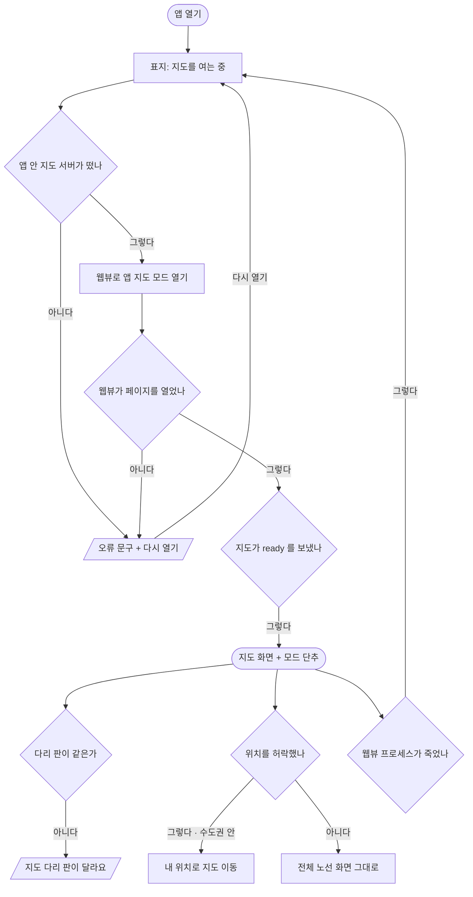

# 앱 열기 → 지도 화면

앱의 첫 흐름이다. 지금 앱의 화면(라우트)은 지도 화면 `/` 하나이고, 다른 흐름은 모두 이 화면 위에 덧판으로 뜬다.

## 시작점
- 앱 아이콘으로 연다 — 라우트는 `app/src/app/_layout.tsx:9` 의 Stack 아래 `app/src/app/index.tsx:33` 하나
- 백그라운드에서 돌아온다(`app/src/map/MapWebView.tsx:50`)
- 딥링크: `syung` 스킴만 선언돼 있고(`app/app.json:5`) 경로별로 처리하는 코드는 없다

## 흐름도

## 단계
| 단계 | 화면 요소 또는 엔드포인트 | 근거 | 부르는 API | 오류 처리 | 기대 문구 |
|---|---|---|---|---|---|
| 표지 보임 | 표지(`mapState` 없음 · 오류 없음) | `app/src/app/index.tsx:128` | | | 「지도를 여는 중」 |
| 앱 안 지도 서버 띄우기 | `startMapServer` → 네이티브 `MapServer.start` | `app/src/map/source.ts:18` | `http://127.0.0.1:38127` (앱 안) | 실패 → 표지에 오류 문구 + 「다시 열기」 | 「앱 묶음에 지도 파일이 없다」(iOS 만) · 「지도 서버를 띄우지 못했다: …」 |
| 웹뷰 열기 | `MapWebView` — 서버가 뜬 뒤에만 그린다 | `app/src/map/MapWebView.tsx:63` | `MAP_URL`(`/index.html#app`) | `onError` → 표지에 오류 문구 | 「지도를 열지 못했어요.」(설명이 없을 때) |
| 지도만 보이기 | `html[data-app=map]` 이 머리줄 · 검색 · 서랍 · 시트를 숨긴다 | `web/syung.css:1001` | | | |
| 지도 준비 끝 | 다리 `ready` → 모드 단추 · 표지 걷기 | `app/src/app/index.tsx:54` | 지도 → 앱 `ready` | 모양이 다르면 버린다(`app/src/map/bridge.ts:63`) | |
| 다리 판 비교 | `ready.version` 과 `BRIDGE_VERSION` | `app/src/app/index.tsx:55` | | 안내 띠만 띄우고 계속 — 띠를 누르면 닫힌다(`app/src/app/index.tsx:147`) | 「지도 다리 판이 달라요(지도 N · 앱 N)」 |
| 위치 묻기 | 지도 load 뒤 한 번 `getCurrentPosition` | `web/maplibre_runtime.mts:369` | 기기 위치 | 거부 · 실패 → 조용히 전체 노선 화면 | |
| 내 위치 단추 실패 | 지도 안 내 위치 단추의 권한 거부 | `web/maplibre_runtime.mts:364` | 기기 위치 | 지도 위 안내 | 「위치를 가져오지 못했어요. 브라우저의 위치 권한을 확인해 주세요.」 |
| 앱 복귀 | `AppState` 가 `active` → 서버 다시 띄우기 | `app/src/map/MapWebView.tsx:50` | 네이티브 `MapServer.start` | 실패 → 표지에 오류 문구 | |
| 웹뷰 프로세스 복구 | `onContentProcessDidTerminate` · `onRenderProcessGone` → 다시 읽기 | `app/src/map/MapWebView.tsx:61` | | 시트 · 모드 목록을 닫고 `ready` 를 다시 기다린다(`app/src/app/index.tsx:71`) | 「지도를 여는 중」 |
| 바깥 링크 | 지도 출처 밖 http(s) 이동 → 시스템 브라우저 | `app/src/map/MapWebView.tsx:23` | | 웹뷰 안에서는 열지 않는다 | |

## 갈림길
- **지도 서버 실패** — 서버가 뜨지 않으면 표지에 오류 문구와 「다시 열기」가 보이고, 누르면 서버부터 다시 띄운다(`app/src/app/index.tsx:137` · `app/src/map/MapWebView.tsx:57`)
- **웹뷰 열기 실패** — 웹뷰 `onError` 도 같은 오류 표지로 간다(`app/src/map/MapWebView.tsx:87`)
- **다리 판이 다름** — 안내 띠가 뜨고 지도는 그대로 쓴다. 지금 코드는 앱 1(`app/src/map/bridge.ts:4`) · 웹 2(`web/ui/app_bridge.mts:14`)라 같은 커밋의 지도를 실으면 띠가 뜬다
- **위치 허락 · 수도권 안** — 내 위치 표시를 켜고 지도를 옮긴다(`web/maplibre_runtime.mts:373`)
- **위치 거부 · 수도권 밖** — 전체 노선 화면 그대로(`web/maplibre_runtime.mts:372`)
- **앱 복귀** — 서버만 다시 띄운다. 지도 페이지는 다시 읽지 않는다
- **웹뷰 프로세스 죽음** — 표지로 돌아가 `ready` 를 다시 기다린다. 그려 둔 경로는 `ready` 때 다시 그린다(`app/src/app/index.tsx:58`)

## 끝점
지도 화면에 모드 단추가 보이고 역 · 열차를 누를 수 있다 → [02 역 · 길찾기](02-station-route.md) · [03 열차 시트](03-train-sheet.md) · [04 모드 바꾸기](04-mode-picker.md). 안드로이드 뒤로가기는 열린 것이 없으면 시스템 기본으로 넘긴다(`app/src/app/index.tsx:109`).

## 확인 필요
- 이 문서는 main 에 들어온 `app/` 코드(1단계 시제품)만 적었다. 로그인 · 승차권 등 진행 중인 앱 브랜치의 화면은 머지되면 더한다
- **다리 판 안내**: 앱 1 · 웹 2 인 지금 안내 띠가 늘 뜨는지 실기기에서 못 봤다. 의도한 상태인지(웹 v2 는 v1 호환 · 앱이 v2 로 올라갈 때까지) 제품 쪽 확인이 필요하다
- **딥링크**: `syung://` 로 들어왔을 때와 없는 경로일 때 무엇이 보이는지 앱 코드에 처리가 없어 Expo Router 기본 동작에 달렸다 — 확인 못 함
- **위치 권한 창**: iOS 웹뷰(`NSLocationWhenInUseUsageDescription` · `app/app.json:13`)와 Android(`app/app.json:25`) · `geolocationEnabled`(`app/src/map/MapWebView.tsx:72`)에서 권한 창이 언제 · 몇 번 뜨는지 코드로 확정 못 했다. 앱 안에서 「브라우저의 위치 권한」이라는 문구가 맞는지도 정해지지 않았다
- **지도가 안 뜰 때**: `ready` 를 기다리는 시간 제한이 없어 지도가 멈추면 표지가 계속 남는다. Android 는 서버 시작 때 지도 파일을 검사하지 않고(`app/modules/map-server/android/src/main/java/com/novumlab/syung/mapserver/MapServerModule.kt:29`) 404 를 다루는 `onHttpError` 도 없다 — 이때 실제 화면은 확인 못 함
- **실시간 끊김 · 서버 CORS**: 앱 지도 모드는 실시간 상태 줄을 숨기고(`web/syung.css:1001`) 앱은 `status` 를 받지 않는다. 끊겼을 때 무엇이 보이는지 확인 못 함. 운영 CORS 는 `server/Caddyfile.example:23` 의 출처 하나에만 열려 있어 포트를 바꾸면 같이 바꿔야 한다

## 체크리스트
iOS · Android 둘 다 본다.
- [ ] 앱을 처음 열면 「지도를 여는 중」 표지가 보이고, 지도가 뜨면 표지가 걷히고 오른쪽 위에 모드 단추가 보인다
- [ ] 지도 화면에 웹의 머리줄 · 검색 · 메뉴 · 아래 시트가 보이지 않는다
- [ ] 안내 띠 「지도 다리 판이 달라요(지도 2 · 앱 1)」이 뜨면 눌러서 닫을 수 있고, 지도는 계속 쓸 수 있다
- [ ] 위치 권한을 허락하고 수도권 안에 있으면 내 위치로 지도가 옮겨 간다
- [ ] 위치 권한을 거부해도 앱이 멈추지 않고 전체 노선 화면이 그대로 보인다
- [ ] 앱을 백그라운드로 보냈다 돌아오면 지도가 그대로 보이고 열차가 계속 움직인다
- [ ] 비행기 모드로 앱을 열어도 앱이 죽지 않는다(지도가 어디까지 뜨는지 · 표지가 남는지 결과를 적는다)
- [ ] 느린 네트워크에서 앱을 열어도 표지 뒤 지도가 끝내 뜬다
- [ ] 지도 안 저작권 링크를 누르면 웹뷰가 아니라 시스템 브라우저로 열린다
- [ ] (Android) 열린 것이 없을 때 뒤로가기를 누르면 앱을 나간다
- [ ] `syung://` 링크로 앱을 열면 지도 화면이 뜬다(확인 필요 항목 — 결과를 적는다)
