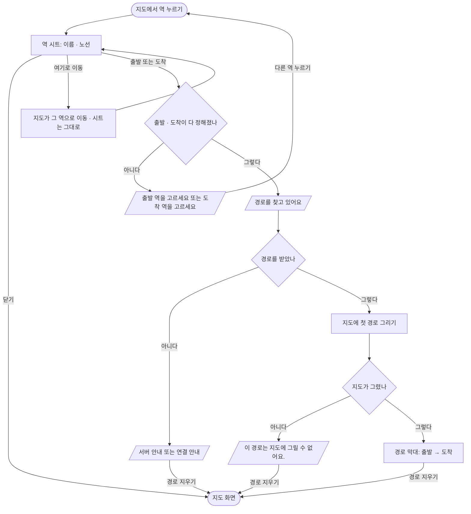

# 역 누르기 → 역 시트 → 길찾기 경로

## 시작점
[01 앱 열기](01-launch-map.md) 뒤 지도 화면에서 역을 누른다. 지도가 다리 `stationTap` 으로 알리면(`web/maplibre_runtime.mts:685`) 앱이 역 시트를 연다.

## 흐름도

## 단계
| 단계 | 화면 요소 또는 엔드포인트 | 근거 | 부르는 API | 오류 처리 | 기대 문구 |
|---|---|---|---|---|---|
| 역 누름 받기 | 다리 `stationTap` → 시트 열기 · 모드 목록 닫기 | `app/src/app/index.tsx:60` | 지도 → 앱 `stationTap` | 모양이 다르면 버린다(`app/src/map/bridge.ts:65`) | |
| 역 시트 | `Sheet` 제목 = 역 이름 · 부제 = 노선 목록 · ✕(「닫기」) | `app/src/app/index.tsx:171` | | | 「<노선> · <노선>」 |
| 여기로 이동 | 「여기로 이동」 | `app/src/app/index.tsx:174` | 앱 → 지도 `focusStation` | 지도에 없는 역 → 다리 `error`(앱은 경고 로그만) | |
| 출발 · 도착 고르기 | 「출발」 · 「도착」 → 시트 닫기 | `app/src/app/index.tsx:114` | | | 막대에 「출발 역을 고르세요」 또는 「도착 역을 고르세요」 |
| 경로 찾기 | 둘 다 정해지면 앞 찾기를 버리고 앞 경로를 지운 뒤 찾는다 | `app/src/app/index.tsx:85` | `GET /api/route?from=위도,경도&to=위도,경도` | 아래 갈림길 | 「경로를 찾고 있어요」 |
| 응답 읽기 | `findRoute` — `plans[0]` 만 쓴다 | `app/src/api/route.ts:22` | `GET /api/route` | 서버 `error` 글자 또는 기본 문구 | 「출발지나 도착지를 바꿔 보세요.」 |
| 지도에 그리기 | 경로를 기억하고 막대 높이만큼 여백을 준다 | `app/src/app/index.tsx:95` | 앱 → 지도 `showRoute` | 지도 `error`(request `showRoute`) → 실패 문구 | 「이 경로는 지도에 그릴 수 없어요.」 |
| 경로 막대 | 시트가 닫혀 있을 때만 보인다 | `app/src/app/index.tsx:163` | | | 「<출발> → <도착>」 |
| 경로 지우기 | 「경로 지우기」 — 찾기 취소 · 역 비우기 · 지도 지우기 | `app/src/app/index.tsx:77` | 앱 → 지도 `clearRoute` | | |
| 시트 닫기 | ✕ | `app/src/components/Sheet.tsx:22` | | | |

## 갈림길
- **한쪽만 고름** — 막대가 뜨고 「출발 역을 고르세요」 또는 「도착 역을 고르세요」가 보인다(`app/src/app/index.tsx:165`). 경로는 찾지 않는다
- **연결 실패** — 요청이 실패하거나 JSON 이 아니면 「연결이 불안정해요. 잠시 뒤 다시 찾아 주세요.」(`app/src/api/route.ts:19`)
- **응답 모양이 다름** — 객체가 아니면 「경로를 받지 못했어요.」(`app/src/api/route.ts:21`)
- **경로 없음** — `ok` 가 거짓이거나 `plans[0].legs` 가 없으면 서버 `error` 글자, 없으면 「출발지나 도착지를 바꿔 보세요.」(`app/src/api/route.ts:24` · 서버 `server/routes/journey.py:14`)
- **지도에 못 그림** — 지도가 `showRoute` 를 거절하면 기억한 경로를 버리고 실패 문구를 보인다(`app/src/app/index.tsx:65`)
- **다시 찾기** — 경로가 있는데 출발 · 도착을 바꾸면 앞 찾기를 취소하고 앞 경로를 먼저 지운다(`app/src/app/index.tsx:90`)
- **지도가 다시 뜸** — 웹뷰가 다시 뜨면 시트는 닫히고, 그려 둔 경로는 `ready` 때 다시 그린다(`app/src/app/index.tsx:58`)
- **안드로이드 뒤로가기** — 모드 목록 → 시트 → 경로 차례로 닫는다(`app/src/app/index.tsx:104`)

## 끝점
경로 막대가 떠 있는 지도 화면, 또는 「경로 지우기」 · 시트 닫기로 돌아온 지도 화면.

## 확인 필요
- 출발과 도착이 같은 역이면 앱은 막지 않고 그대로 `/api/route` 를 부른다 — 이때 응답 · 화면은 확인 못 함
- `findRoute` 에 시간 제한이 없어(`app/src/api/route.ts:15`) 응답이 오래 안 오면 「경로를 찾고 있어요」가 계속 남는다. 제품 동작으로 괜찮은지 정해지지 않았다
- 지도가 `ready` 전일 때 `showRoute` 가 나가면(`app/src/app/index.tsx:96` 은 `mapState` 를 보지 않는다) `not_ready` 오류로 실패 문구가 뜰 것으로 읽히나, 실제로 재현은 못 함
- 시트 · 막대를 실기기에서 눌러 본 기록은 없다(앱 계획서 — 시뮬레이터에서 누르는 도구가 없어 코드 · 타입 · lint 까지)

## 체크리스트
iOS · Android 둘 다 본다.
- [ ] 역을 누르면 아래 시트에 역 이름과 노선이 보인다
- [ ] 시트의 ✕ 를 누르면 시트가 닫히고 지도가 그대로 보인다
- [ ] 「여기로 이동」을 누르면 지도가 그 역으로 옮겨 가고 시트는 열린 채다
- [ ] 「출발」을 누르면 시트가 닫히고 막대에 「<역> → 도착 역을 고르세요」가 보인다
- [ ] 「도착」을 먼저 누르면 막대에 「출발 역을 고르세요 → <역>」가 보인다
- [ ] 다른 역에서 나머지를 고르면 「경로를 찾고 있어요」 뒤 지도에 경로가 그려지고 막대가 경로를 가리지 않는다
- [ ] 비행기 모드에서 두 역을 고르면 「연결이 불안정해요. 잠시 뒤 다시 찾아 주세요.」가 보인다
- [ ] 「경로 지우기」를 누르면 막대와 지도의 경로가 함께 사라진다
- [ ] 경로가 있을 때 도착 역을 바꾸면 옛 경로가 사라지고 새 경로가 그려진다
- [ ] 찾는 중에 「경로 지우기」를 누르면 뒤늦게 경로가 그려지지 않는다
- [ ] 경로를 그린 채 앱을 백그라운드에 오래 뒀다 돌아와도 경로가 남아 있다
- [ ] (Android) 시트가 열린 채 뒤로가기를 누르면 시트만 닫히고, 한 번 더 누르면 경로가 지워진다
