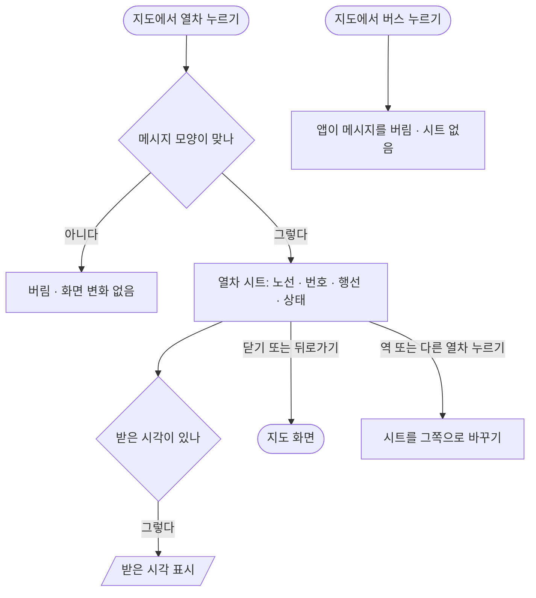

# 열차 누르기 → 열차 시트

## 시작점
[01 앱 열기](01-launch-map.md) 뒤 지도 화면에서 열차를 누른다. 앱 지도 모드의 웹은 자기 시트 대신 다리 `trainTap` 으로 알린다(`web/maplibre_runtime.mts:630`).

## 흐름도

## 단계
| 단계 | 화면 요소 또는 엔드포인트 | 근거 | 부르는 API | 오류 처리 | 기대 문구 |
|---|---|---|---|---|---|
| 열차 누름 받기 | 다리 `trainTap` → 시트 열기 · 모드 목록 닫기 | `app/src/app/index.tsx:61` | 지도 → 앱 `trainTap` | 모양이 다르면 버린다(`app/src/map/bridge.ts:44`) | |
| 시트 제목 | `Sheet` 제목 = 노선 + 열차 번호 | `app/src/app/index.tsx:181` | | | 「<노선> <번호>」 |
| 시트 부제 | 행선 · 방향 · 급행 · 막차 | `app/src/app/index.tsx:22` | | 빈 칸은 뺀다 | 「<행선>행 · <방향> · 급행 · 막차」 |
| 지금 자리 | 역 + 상태 | `app/src/app/index.tsx:182` | | | 「<역> <상태>」 |
| 받은 시각 | `receivedAt` 이 있을 때만 | `app/src/app/index.tsx:183` | | `null` 이면 줄이 없다 | 「받은 시각 <시각>」 |
| 시트 닫기 | ✕ | `app/src/components/Sheet.tsx:22` | | | |

## 갈림길
- **받은 시각 없음** — `receivedAt` 이 `null` 이면 그 줄을 그리지 않는다(`app/src/map/bridge.ts:49`)
- **급행 · 막차 아님** — 부제에서 그 말을 뺀다(`app/src/app/index.tsx:23`)
- **다른 역 · 열차 누름** — 시트 내용이 그쪽으로 바뀐다(`app/src/app/index.tsx:60`)
- **버스 누름** — 웹은 시트 대신 다리로 보내지만(`web/maplibre_runtime.mts:702`) 앱은 `busTap` 을 모르는 메시지로 버려(`app/src/map/bridge.ts:79`) 앱 화면은 변하지 않는다
- **지도가 다시 뜸** — 시트가 닫힌다(`app/src/app/index.tsx:73`)
- **안드로이드 뒤로가기** — 시트를 닫는다(`app/src/app/index.tsx:107`)

## 끝점
시트를 닫은 지도 화면, 또는 다른 역 · 열차의 시트 → 역이면 [02 역 · 길찾기](02-station-route.md).

## 확인 필요
- 시트 값은 누른 순간의 값 그대로다 — 다리 v2 의 `trainUpdate` · `trainGone`(`web/ui/app_bridge.mts:42`)을 앱이 아직 받지 않아 열차가 움직여도, 사라져도 시트는 그대로다. 앱 v2 전까지 이대로 두는지 확인 필요
- `receivedAt.slice(11)` 은 글자 자르기라(`app/src/app/index.tsx:183`) `receivedAt` 형식이 `YYYY-MM-DDTHH:MM:SS` 꼴이어야 시각만 남는다 — 실제 값으로 확인 못 함
- 앱 지도 모드에 버스가 보이는지 · 버스를 눌렀을 때 지도 쪽 표시가 남는지 확인 못 함
- 역과 열차가 겹친 자리에서는 지도 쪽이 열차를 먼저 고른다(`web/maplibre_runtime.mts:685`) — 실기기 손가락 크기에서 고르기 쉬운지 확인 못 함

## 체크리스트
iOS · Android 둘 다 본다.
- [ ] 열차를 누르면 아래 시트에 「<노선> <번호>」와 「<행선>행 · <방향>」이 보인다
- [ ] 급행 · 막차 열차면 부제에 「급행」 · 「막차」가 함께 보인다
- [ ] 시트에 「<역> <상태>」와 「받은 시각 <시각>」이 보인다
- [ ] 시트 어디에도 「N분 뒤」 같은 시간표 예측 안내가 없다
- [ ] 시트가 열린 채 다른 열차를 누르면 그 열차로 바뀌고, 역을 누르면 역 시트로 바뀐다
- [ ] ✕ 를 누르면 시트가 닫힌다
- [ ] (Android) 시트가 열린 채 뒤로가기를 누르면 앱이 나가지 않고 시트만 닫힌다
- [ ] 버스를 눌러도 앱이 멈추거나 빈 시트가 뜨지 않는다
