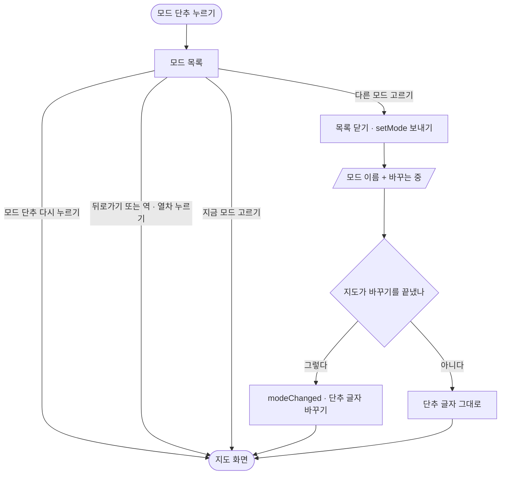

# 모드 단추 → 모드 바꾸기

## 시작점
[01 앱 열기](01-launch-map.md) 뒤 지도 화면 오른쪽 위 모드 단추. 지도의 `ready` 를 받은 뒤에만 보인다(`app/src/app/index.tsx:141`).

## 흐름도

## 단계
| 단계 | 화면 요소 또는 엔드포인트 | 근거 | 부르는 API | 오류 처리 | 기대 문구 |
|---|---|---|---|---|---|
| 모드 단추 | 지금 모드 이름 · 접근성 글 | `app/src/app/index.tsx:142` | | 모르는 id 는 id 그대로(`app/src/map/modes.ts:7`) | 「기본」 · 접근성 「모드 바꾸기, 지금 기본」 |
| 모드 목록 | `ready.modes` 차례대로 · 지금 모드는 굵게 | `app/src/app/index.tsx:149` | | | `app/src/map/modes.ts:2` 의 이름 |
| 고르기 | 목록을 닫고, 다른 모드일 때만 보낸다 | `app/src/app/index.tsx:155` | 앱 → 지도 `setMode` | 없는 모드 → 다리 `error`(앱은 경고 로그만 · `app/src/app/index.tsx:64`) | |
| 바꾸는 중 표시 | 지도 쪽 `.mode-busy` — 앱 지도 모드에서도 보인다 | `web/maplibre_runtime.mts:880` | | | 「<모드>로 바꾸는 중」 · 「모드 자료 받는 중」 · 「롤코 자료 받는 중」 |
| 바뀜 알림 | 지도가 바꾸기를 끝내면 알린다 → 단추 글자 | `web/maplibre_runtime.mts:410` | 지도 → 앱 `modeChanged` | | |
| 단추 글자 갱신 | `mapState.mode` 바꾸기 | `app/src/app/index.tsx:62` | | | 고른 모드 이름 |

## 갈림길
- **지금 모드를 고름** — 목록만 닫고 아무것도 보내지 않는다(`app/src/app/index.tsx:155`)
- **모드 바꾸기 실패** — `modeChanged` 가 오지 않아 단추 글자가 그대로다. 앱에 따로 뜨는 실패 문구는 없다(`web/maplibre_runtime.mts:409`)
- **역 · 열차 누름** — 모드 목록이 닫히고 시트가 열린다(`app/src/app/index.tsx:60`)
- **지도가 다시 뜸** — 단추와 목록이 사라지고 `ready` 때 다시 나온다(`app/src/app/index.tsx:71`)
- **안드로이드 뒤로가기** — 목록을 가장 먼저 닫는다(`app/src/app/index.tsx:106`)

## 끝점
지도 화면 — 고른 모드로 바뀌었으면 단추 글자도 그 이름이다.

## 확인 필요
- 앱에서 고른 모드가 앱을 다시 열거나 웹뷰가 다시 떠도 남는지 앱 코드로 확정 못 한다(앱은 저장하지 않고 `ready.mode` 를 그대로 믿는다)
- `modes.ts` 의 이름표는 웹 `web/modes/<모드>/index.mts` 의 label 을 손으로 옮긴 것이다 — 웹에 새 모드가 생기면 앱 목록에는 id 글자로 보인다. 모드 수가 많을 때 목록 스크롤(최대 높이 360 · `app/src/app/index.tsx:200`)을 실기기에서 못 봤다
- 무거운 모드(조선 · 스타크래프트 등)의 휴대폰 메모리 · 속도는 이 문서 범위 밖이고 앱 계획서의 실기기 측정이 아직 남아 있다

## 체크리스트
iOS · Android 둘 다 본다.
- [ ] 지도가 뜨기 전에는 모드 단추가 안 보이고, 뜨면 「기본」이 보인다
- [ ] 단추를 누르면 모드 목록이 열리고 지금 모드가 굵게 보인다. 다시 누르면 닫힌다
- [ ] 목록의 이름이 모두 한글 이름이다(영문 id 가 보이지 않는다)
- [ ] 목록이 화면을 넘으면 스크롤된다
- [ ] 지금 모드를 고르면 목록만 닫히고 지도는 그대로다
- [ ] 다른 모드를 고르면 「<모드>로 바꾸는 중」이 보이고, 끝나면 지도가 그 모드로 바뀌고 단추 글자도 바뀐다
- [ ] 바꾸는 중에 또 다른 모드를 고르면 마지막에 고른 모드로 끝나고 단추 글자가 지도와 같다
- [ ] 느린 네트워크 · 비행기 모드에서 모드를 바꿔도 앱이 죽지 않고 단추 글자가 지도 모드와 어긋나지 않는다
- [ ] 목록이 열린 채 역을 누르면 목록이 닫히고 역 시트가 열린다
- [ ] (Android) 목록이 열린 채 뒤로가기를 누르면 목록만 닫힌다
- [ ] 각 모드에서 앱을 백그라운드에 뒀다 돌아와도 지도와 단추 글자가 같다
