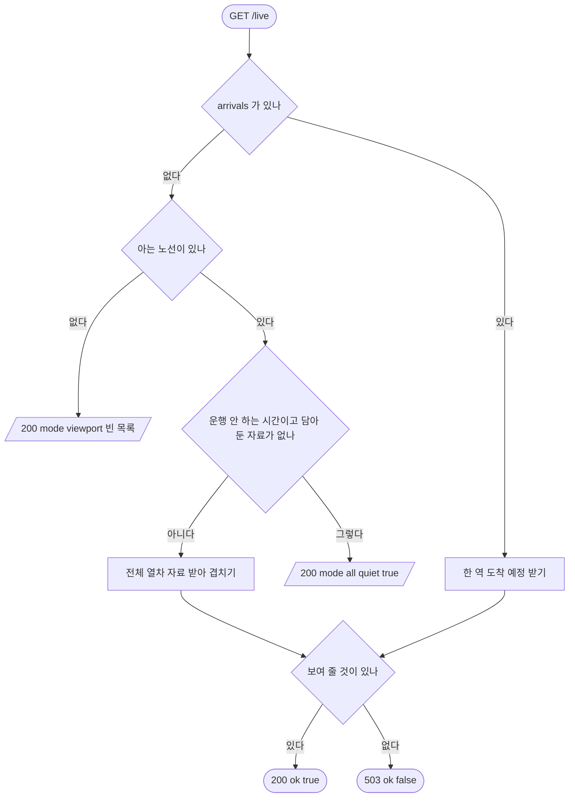

# 실시간 열차 · 서버 상태

## 시작점
지도 화면이 보는 노선의 열차를 받을 때(`GET /live`, 바깥 주소 `/api/live` 는 Caddy 가 `/live` 로 바꿔 넘긴다 — `server/routes/http.py:79`). 관제탑은 `GET /api/health` 로 이상을 본다.

## 흐름도

## 단계
| 단계 | 화면 요소 또는 엔드포인트 | 근거 | 부르는 API | 오류 처리 | 기대 문구 |
|---|---|---|---|---|---|
| 서버 살아 있나 | `GET /health` | `server/routes/http.py:71` | 없음 | 없음 | 200 `{ok:true}` |
| 이상 감지 | `GET /api/health` | `server/routes/http.py:73` · `server/services/health.py:109` | 없음(바깥 API 안 부름) | 늘 200 | `{ok, checkedAt, baselineDay, checks:[{key, ok, text}]}` |
| 입력 읽기 | `GET /live` | `server/routes/live.py:10` | 없음 | 글자 정리만 | 없음 |
| 역 도착 예정 | `GET /live?arrivals=<역>` | `server/routes/live.py:16` · `server/services/live.py:426` | 서울 실시간 도착 API | `ok:false` → 503 | 200 또는 503 |
| 노선 고르기 | `GET /live?lines=<노선>` | `server/services/live.py:699` · `server/services/live.py:710` | 없음 | 없는 노선은 버림 | 노선이 없으면 `mode:"viewport"` |
| 운행 안 하는 시간 | `GET /live?lines=<노선>` | `server/services/live.py:397` · `server/services/live.py:455` | 없음 | 없음 | `{ok:true, mode:"all", quiet:true, lines, warnings, trains:[]}` |
| 상태 코드 정하기 | `GET /live` | `server/routes/live.py:20` | 없음 | `ok:false` → 503 | 200 · 503 |
| 사전 요청 | `OPTIONS /live` | `server/routes/http.py:81` · `server/routes/http.py:160` | 없음 | 공개 주소가 아니면 501 | 204 · 501 |
| 없는 주소 | `GET /nope` | `server/routes/http.py:263` | 없음 | 404 | 404 |

## 갈림길
- **서버 살아 있음** — `/health` 는 언제나 200 `{ok:true}`
- **이상 감지 보고** — `/api/health` 는 문제가 있어도 200, 칸별 결과는 `checks`
- **보는 노선 없음** — `lines` 가 없으면 200 `mode:"viewport"` 빈 목록
- **없는 노선 이름** — 아는 노선이 아니면 버린다 — 200 빈 `lines`
- **운행 안 하는 시간** — 담아 둔 자료가 없으면 바깥 API 를 부르지 않고 200 `quiet:true`
- **실시간 열차 있음** — 운행 시간에 서울 위치 API 자료로 200
- **보여 줄 것 없음** — 바깥 API 실패 등으로 `ok:false` 면 503
- **역 도착 예정** — `arrivals=<역>` 은 쉬는 시간에도 바깥 API 를 부른다
- **사전 요청 허용** — 공개 GET 주소의 OPTIONS 는 204
- **사전 요청 거절** — 그 밖의 OPTIONS 는 501
- **없는 주소** — 표에 없는 GET 은 404

## 끝점
JSON 응답(200 · 503) 또는 본문 없는 사전 요청 응답으로 끝난다. 표에 없는 주소는 404.

## 확인 필요
`실시간 열차 있음` · `보여 줄 것 없음` · `역 도착 예정` 의 성공 응답 모양은 서울 API 키와 실제 운행 자료가 있어야 확인된다 — 이 문서는 모양을 적지 않았다. 시험은 `docs/flows/qa.json` 의 `be` 설정으로 띄운 로컬 서버에서 돈다 — 바깥 API 를 부르지 않게 키를 비우고, 버스는 가짜 자료(`BUS_LIVE_MODE=mock`), 지하철은 하루 종일 쉬는 시간(`SUBWAY_LIVE_QUIET_HOURS=00:00-24:00`)이다.

**TC 실패(2026-10-30 실행 · 고치지 않음)** — `LIVE-4 없는 노선 이름`: TC 는 `mode:"viewport"` 를 기대했지만 실제 응답은 `{ok:true, mode:"all", quiet:true, lines:[]}` 다. `lines` 를 보내면 없는 노선이어도 `snapshot_all` 을 먼저 타기 때문으로 보인다(`server/services/live.py:701`). TC 기대값이 틀린 것으로 보이며 코드 문제 여부는 확인 못 함. 위 "노선 고르기" 단계의 `mode:"viewport"` 는 `lines` 자체가 없을 때만 확인했다.
