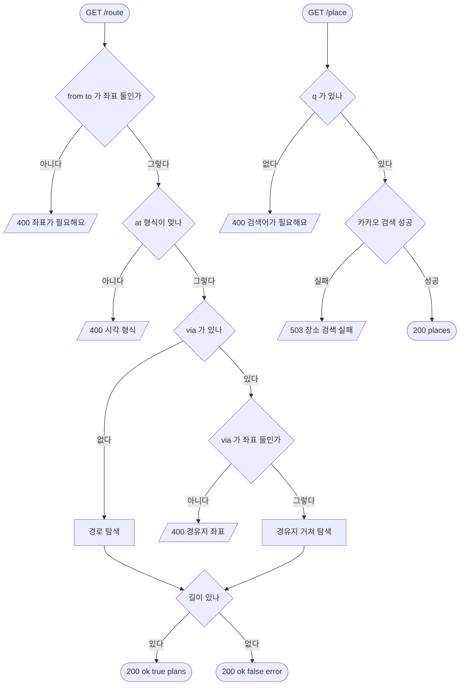

# 길찾기 · 장소 검색

## 시작점
길찾기 시트가 경로를 찾을 때 `GET /route?from=위도,경도&to=위도,경도[&at=…][&via=…]`, 출발 · 도착을 검색할 때 `GET /place?q=…[&near=위도,경도]`.

## 흐름도

## 단계
| 단계 | 화면 요소 또는 엔드포인트 | 근거 | 부르는 API | 오류 처리 | 기대 문구 |
|---|---|---|---|---|---|
| 좌표 검사 | `GET /route` | `server/routes/journey.py:17` · `server/routes/journey.py:22` | 없음 | 400 | `{ok:false, error}` |
| 시각 검사 | `GET /route?at=` | `server/routes/journey.py:25` · `server/routes/journey.py:27` | 없음 | 400 | "시각은 YYYY-MM-DDTHH:MM 형식이에요" |
| 경유지 검사 | `GET /route?via=` | `server/routes/journey.py:32` · `server/routes/journey.py:36` | 없음 | 400 | "경유지 좌표는 via=위도,경도 예요" |
| 경로 탐색 | `GET /route` | `server/routes/journey.py:30` · `server/services/journey_graph.py:911` | 없음(지금 시각 근처면 실시간 열차를 겹친다 `server/services/journey.py:77`) | 못 찾아도 200 | `{ok, at, straightMetres, plans:[…], searched}` |
| 걷기 후보 | `GET /route` | `server/services/journey_graph.py:919` · `server/services/journey_graph.py:926` | 없음 | 없음 | `tag:"걸어가기"`, `kind:"walk"` |
| 길 없음 문구 | `GET /route` | `server/services/journey_graph.py:907` | 없음 | 200 `ok:false` | "이 시각에는 다니는 열차·버스가 없거나, 가까운 역·정류장에서 이어지는 경로를 찾지 못했어요." |
| 검색어 검사 | `GET /place` | `server/routes/journey.py:42` · `server/routes/journey.py:44` | 없음 | 400 | "검색어가 필요해요" |
| 장소 검색 | `GET /place?q=` | `server/services/places.py:21` · `server/sources/kakao.py:13` | 카카오 로컬 검색 | 실패 → 503 `server/routes/journey.py:51` | `{ok:true, places}` · `{ok:false, error:"장소 검색 실패: …"}` |

## 갈림길
- **좌표 없음** — `from` · `to` 가 없거나 숫자 둘이 아니면 400
- **시각 형식 틀림** — `at` 이 형식에 안 맞으면 400
- **경유지 형식 틀림** — `via` 가 유한한 숫자 둘이 아니면 400
- **길 찾음** — 탈것 경로가 있으면 200 `ok:true`
- **가까워서 걸어감** — 직선 2.5 km 안이고 걷는 쪽이 낫거나 탈것이 없으면 `걸어가기` 경로
- **경유지 거쳐 길 찾음** — `via` 를 지나는 경로로 200 `ok:true`
- **길 없음** — 찾지 못해도 상태는 200 — `ok:false` 와 문구
- **실시간 겹침** — 지금 시각 근처의 탐색만 실시간 열차를 겹친다
- **검색어 없음** — `q` 가 비거나 공백이면 400
- **장소 검색 실패** — 키가 없거나 카카오가 실패하면 503
- **장소 찾음** — 카카오 응답을 10분 담아 두고 200

## 끝점
`/route` 는 입력이 맞으면 찾든 못 찾든 200, `/place` 는 200 또는 503.

## 확인 필요
`장소 찾음` 의 `places` 칸 모양과 `실시간 겹침` 결과는 카카오 키 · 실제 운행 자료가 있어야 확인된다 — 이 문서는 칸을 적지 않았다. `JOURNEY_WORKERS=0` 이면 탐색을 하나도 돌리지 않아(`server/services/journey_graph.py:704`) 늘 `길 없음` 이 나온다 — 시험 설정은 1 이다. 시험은 `docs/flows/qa.json` 의 `be` 설정으로 띄운 로컬 서버에서 돈다 — 바깥 API 를 부르지 않게 키를 비우고, 버스는 가짜 자료(`BUS_LIVE_MODE=mock`), 지하철은 하루 종일 쉬는 시간(`SUBWAY_LIVE_QUIET_HOURS=00:00-24:00`)이다.
