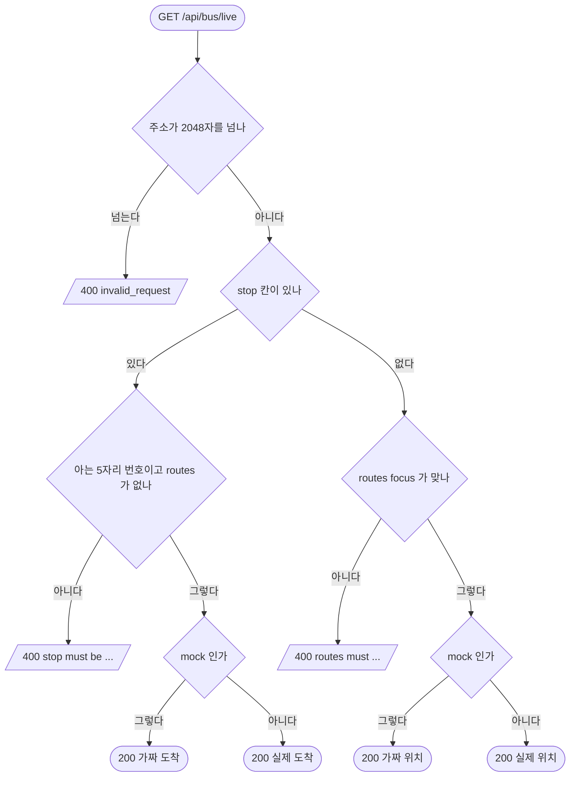

# 버스 위치 · 정류장 도착

## 시작점
지도 버스 층이 `GET /bus/live` · `GET /api/bus/live?routes=<노선>&focus=<노선>` 을, 버스 시트가 `GET /api/bus/live?stop=<정류장 번호>` 를 부른다. 같은 주소라 `stop` 유무로 갈린다.

## 흐름도

## 단계
| 단계 | 화면 요소 또는 엔드포인트 | 근거 | 부르는 API | 오류 처리 | 기대 문구 |
|---|---|---|---|---|---|
| 주소 길이 | `GET /api/bus/live` | `server/routes/http.py:259` | 없음 | 400 | `{ok:false, error:"invalid_request"}` |
| 갈래 고르기 | `GET /api/bus/live` | `server/routes/bus.py:65` | 없음 | 없음 | 없음 |
| 노선 검사 | `?routes=&focus=` | `server/routes/bus.py:31` · `server/routes/bus.py:46` | 없음 | 400 | `{schemaVersion:1, ok:false, error:"invalid_request", message}` |
| 버스 위치 | `?routes=` | `server/services/bus.py:192` · `server/services/bus.py:202` | 서울 버스 위치 API(mock 이면 안 부름) | 노선별 오류는 `errors` | `{schemaVersion, ok, mode, busCount, buses, routes, quota, errors, pollAfterSeconds}` |
| 정류장 검사 | `?stop=` | `server/routes/bus.py:58` | 없음 | 400 | message "stop must be one known 5-digit stop number" |
| 정류장 도착 | `?stop=` | `server/services/bus.py:416` · `server/services/bus.py:423` | 서울 버스 도착 API(mock 이면 안 부름) | 없음 | `{mode, stop, status, arrivals:[{routeId, name, type, direction, buses}]}` |
| 자료 깨짐 | `GET /api/bus/live` | `server/routes/bus.py:41` · `server/routes/bus.py:54` | 없음 | 503 | 서비스의 `catalog_error` 본문 |

## 갈림길
- **주소 너무 김** — 요청 주소가 2048자를 넘으면 400
- **노선 없이 부름** — `routes` 가 없으면 200 빈 위치
- **노선 지정** — 아는 노선이면 200 위치 목록
- **모르는 노선** — 9자리 아는 번호가 아니면 400
- **focus 가 routes 밖** — `focus` 가 `routes` 에 없으면 400
- **정류장 지정** — 아는 5자리 번호면 200 도착 목록
- **모르는 정류장** — 모르는 번호면 400
- **정류장과 노선 같이** — `stop` 과 `routes` 를 같이 보내면 400
- **실제 위치** — mock 이 아니고 키가 있으면 바깥 API 자료
- **실제 도착** — mock 이 아니고 키가 있으면 바깥 API 자료
- **노선 · 정류장 자료 깨짐** — 자료를 못 읽으면 503

## 끝점
JSON 응답(200 · 400 · 503).

## 확인 필요
`server/routes/bus.py:64` 설명은 `stop=` 이 값이 비어도 정류장 도착이라고 하지만, 실제 `?stop=` 은 `parse_qs` 가 빈 값을 버려 200 버스 위치 응답이 나온다 — 어느 쪽이 맞는지 확인 필요(TC 로 굳히지 않았다). 실제 위치 · 도착과 자료 깨짐 응답의 칸은 로컬에서 확인하지 못했다. 시험은 `docs/flows/qa.json` 의 `be` 설정으로 띄운 로컬 서버에서 돈다 — 바깥 API 를 부르지 않게 키를 비우고, 버스는 가짜 자료(`BUS_LIVE_MODE=mock`), 지하철은 하루 종일 쉬는 시간(`SUBWAY_LIVE_QUIET_HOURS=00:00-24:00`)이다.

**TC 실패(2026-10-30 실행 · 고치지 않음)** — `BUS-6 정류장 지정`: TC 는 `arrivals[].direction` 을 글자로 기대했지만 mock 응답은 `null` 이다. TC 기대값이 틀린 것으로 보인다. 실제 도착 응답의 `direction` 이 글자인지는 확인 못 함.
