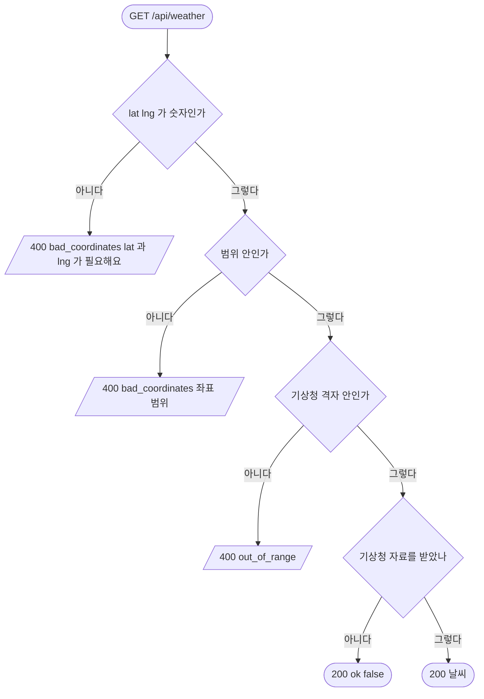

# 날씨

## 시작점
메뉴 하늘 그림이 `GET /api/weather?lat=&lng=` 를 부른다.

## 흐름도

## 단계
| 단계 | 화면 요소 또는 엔드포인트 | 근거 | 부르는 API | 오류 처리 | 기대 문구 |
|---|---|---|---|---|---|
| 숫자 검사 | `GET /api/weather` | `server/routes/weather.py:15` · `server/routes/weather.py:17` | 없음 | 400 | `bad_coordinates` "lat 과 lng 가 필요해요" |
| 범위 검사 | `GET /api/weather` | `server/routes/weather.py:18` | 없음 | 400 | `bad_coordinates` "좌표 범위가 맞지 않아요" |
| 격자 검사 | `GET /api/weather` | `server/routes/weather.py:21` · `server/services/weather.py:100` | 없음 | 400 | `out_of_range` "기상청 격자 밖이에요" |
| 날씨 받기 | `GET /api/weather` | `server/services/weather.py:140` · `server/services/weather.py:144` | 기상청 단기예보 | 실패해도 200 `{ok:false}` | `{ok:false}` 또는 날씨 본문 |

## 갈림길
- **좌표 없음** — `lat` · `lng` 가 없거나 숫자가 아니면 400
- **좌표 범위 밖** — 위도 · 경도 범위 밖이거나 nan 이면 400
- **격자 밖** — 범위 안이지만 기상청 격자 밖이면 400
- **날씨 못 받음** — 키가 없거나 기상청이 실패하면 200 `{ok:false}`
- **날씨 받음** — 기상청 자료를 받으면 200

## 끝점
JSON 응답(200 · 400).

## 확인 필요
`날씨 받음` 의 응답 칸은 기상청 키가 있어야 확인된다 — 이 문서는 칸을 적지 않았다. 시험은 `docs/flows/qa.json` 의 `be` 설정으로 띄운 로컬 서버에서 돈다 — 바깥 API 를 부르지 않게 키를 비우고, 버스는 가짜 자료(`BUS_LIVE_MODE=mock`), 지하철은 하루 종일 쉬는 시간(`SUBWAY_LIVE_QUIET_HOURS=00:00-24:00`)이다.
