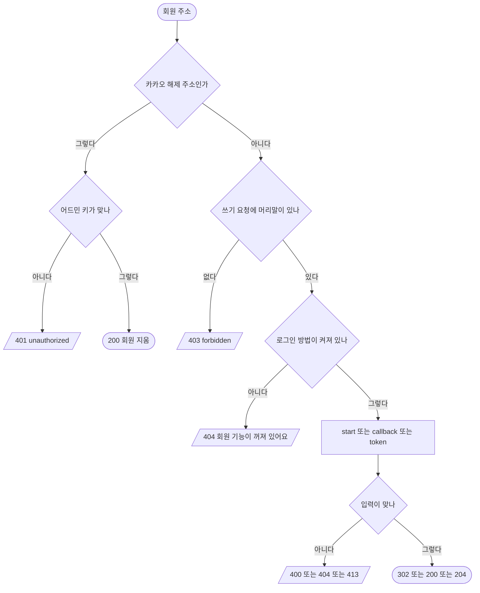

# 회원 로그인 · 앱 토큰 · 로그아웃 · 카카오 해제

## 시작점
웹 · 앱 로그인 줄이 `GET /api/auth/providers` 로 방법을 묻고, `GET /api/auth/<제공자>/start` → 제공자 → `GET /api/auth/<제공자>/callback` 으로 돌아온다. 앱은 딥링크로 받은 코드를 `POST /api/auth/app/token` 으로 바꾼다. 앞의 `/api` 는 있어도 없어도 같다(`server/routes/members.py:79`).

## 흐름도

## 단계
| 단계 | 화면 요소 또는 엔드포인트 | 근거 | 부르는 API | 오류 처리 | 기대 문구 |
|---|---|---|---|---|---|
| 로그인 방법 | `GET /api/auth/providers` | `server/routes/members.py:155` | 없음 | 없음 | `{providers:[…], me}` |
| 쓰기 머리말 | POST · PUT · DELETE | `server/routes/members.py:133` | 없음 | 403 | `forbidden` "이 요청은 슝 화면에서만 할 수 있어요" |
| 꺼진 기능 | 회원 주소 | `server/routes/members.py:157` · `server/services/members.py:283` | 없음 | 404 | "회원 기능이 꺼져 있어요" |
| 로그인 시작 | `GET /api/auth/<제공자>/start` | `server/routes/members.py:322` · `server/routes/members.py:333` | 없음 | 앱 인자 틀림 400 · 없는 제공자 404 | 302 제공자로 |
| 돌아오기 | `GET /api/auth/<제공자>/callback` | `server/routes/members.py:362` · `server/routes/members.py:378` | 제공자 토큰 교환 | 실패도 302 `/#login=<코드>` | 302 |
| 앱 토큰 | `POST /api/auth/app/token` | `server/routes/members.py:338` · `server/routes/members.py:354` | 없음 | 413 · 400 | `{token, expiresAt, new, me}` · `invalid_code` |
| 로그아웃 | `POST /api/auth/logout` | `server/routes/members.py:164` | 없음 | 없음 | 204 |
| 카카오 해제 | `GET·POST /api/auth/kakao/unlink` | `server/routes/members.py:265` · `server/services/members.py:538` | 없음 | 401 · 405 · 400 | 200 빈 본문 |

## 갈림길
- **로그인 방법 묻기** — 로그인 없이 200 `{providers, me:null}`
- **로그인 시작** — 아는 제공자면 302
- **없는 제공자** — 시작은 404
- **앱 시작 인자 틀림** — `app=1` 에 S256 challenge 가 없거나 짧으면 400
- **앱 시작** — 맞는 challenge 면 302
- **돌아왔지만 실패** — state · 제공자가 안 맞으면 302 `/#login=<코드>`
- **로그인 성공** — 302 `/#login=ok` 또는 `new`, 세션 쿠키
- **앱 토큰 머리말 없음** — 머리말이 없으면 403
- **앱 토큰 본문 없음** — 본문이 없으면 413
- **앱 토큰 칸 틀림** — `code` · `codeVerifier` 가 글자가 아니면 400
- **앱 토큰 코드 틀림** — 맞지 않으면 400 `invalid_code`
- **앱 토큰 받음** — 맞으면 200 토큰
- **로그아웃 머리말 없음** — 머리말이 없으면 403
- **로그아웃** — 머리말이 있으면 204
- **카카오 해제 키 틀림** — 키가 없거나 틀리면 401
- **카카오 해제 잘못된 방식** — GET · POST 가 아니면 405
- **카카오 해제 성공** — 맞는 키와 회원번호면 200
- **회원 기능 꺼짐** — 로그인 방법이 하나도 없으면 404

## 끝점
302(제공자 · 앱 · 화면으로), 200 · 204, 또는 `{error:{code,message}}` 오류.

## 확인 필요
실행기는 `Location` 머리를 검사하지 않아 302 의 행선지(`/#login=<코드>` 등)는 TC 가 확인하지 않는다 — 로컬 `curl` 로만 봤다. `broken JSON` 400 은 실행기가 JSON 본문만 보낼 수 있어 TC 가 없다. 시험 설정의 `GOOGLE_*` · `KAKAO_ADMIN_KEY` 값은 기능을 켜려는 가짜 글자로 실제 키가 아니다. `회원 기능 꺼짐` 은 다른 서버 설정이 필요하다.
