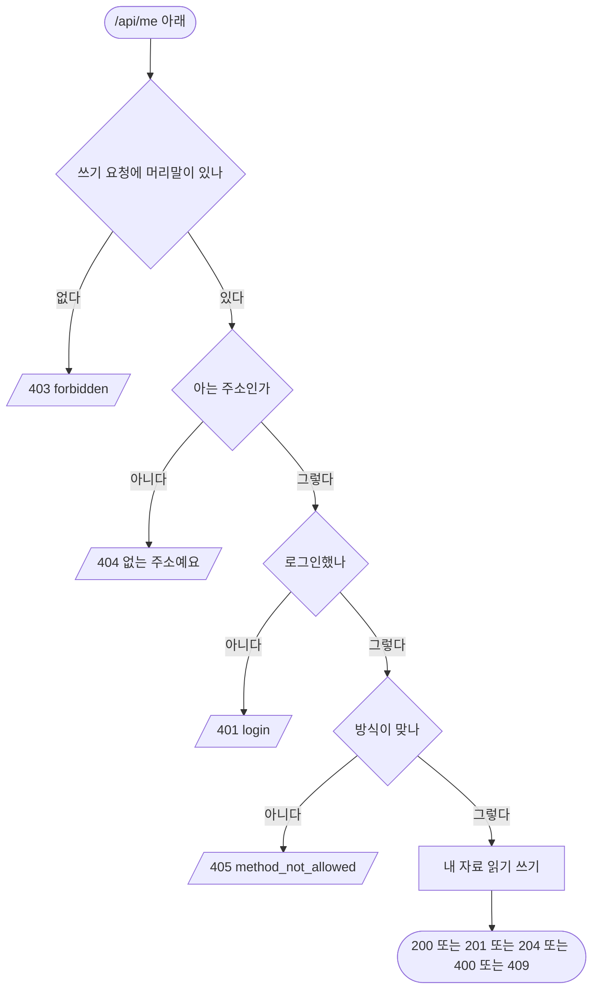

# 내 정보 · 승차권 · 기기 · 통계

## 시작점
로그인한 화면과 앱이 `/api/me` 아래를 부른다. 웹은 세션 쿠키, 앱은 `Authorization: Bearer`(`server/routes/members.py:97`).

## 흐름도

## 단계
| 단계 | 화면 요소 또는 엔드포인트 | 근거 | 부르는 API | 오류 처리 | 기대 문구 |
|---|---|---|---|---|---|
| 쓰기 머리말 | POST · PUT · DELETE | `server/routes/members.py:133` | 없음 | 403 | `forbidden` |
| 주소 검사 | `/api/me/*` | `server/routes/members.py:170` | 없음 | 404 | `not_found` "없는 주소예요" |
| 로그인 검사 | `/api/me/*` | `server/routes/members.py:172` · `server/routes/members.py:175` | 없음 | 401 | `login` "로그인이 필요해요" |
| 내 정보 | `GET · DELETE /api/me` | `server/routes/members.py:180` | 없음 | 없음 | 200 · 204 |
| 프로필 · 사진 | `PUT /api/me/profile` · `PUT · DELETE /api/me/avatar` | `server/routes/members.py:195` · `server/routes/members.py:289` | 없음 | 400 · 413 · 415 | 내 정보 |
| 승차권 | `GET · POST /api/me/tickets` · `PUT · DELETE /api/me/tickets/<번호>` | `server/routes/members.py:203` · `server/routes/members.py:208` · `server/routes/members.py:317` | 없음 | 400 · 404 · 409 | `{tickets}` · 201 · 204 |
| 기기 · 통계 · 내보내기 | `/api/me/sessions` · `stats` · `usage` · `export` | `server/routes/members.py:225` | 없음 | 400 · 404 · 405 | 200 · 204 |

## 갈림길
- **쓰기 머리말 없음** — 머리말이 없는 쓰기 요청은 로그인보다 먼저 403
- **없는 내 주소** — 모르는 주소 · 숫자가 아닌 승차권 번호는 로그인 전에 404
- **로그인 안 함** — 쿠키도 Bearer 도 없으면 401
- **틀린 토큰** — 틀린 Bearer 면 401
- **내 정보 보기** — 로그인했으면 200
- **탈퇴** — 로그인 후 DELETE 면 204
- **프로필 바꾸기** — 로그인 후 이름 · 사진 · 캐릭터 저장
- **승차권 쓰기** — 로그인 후 목록 · 추가 · 수정 · 삭제
- **승차권 장수 한도** — 한도를 넘으면 409
- **기기 · 통계 · 내보내기** — 로그인 후 내 자료
- **방식 틀림** — 로그인 후 주소에 없는 방식이면 405

## 끝점
`{error:{code,message}}` 오류 또는 내 자료 응답.

## 확인 필요
로그인한 뒤 응답의 칸은 세션이 있어야 확인된다 — 이 문서는 칸을 적지 않았고 해당 TC 는 사람 확인이다.
