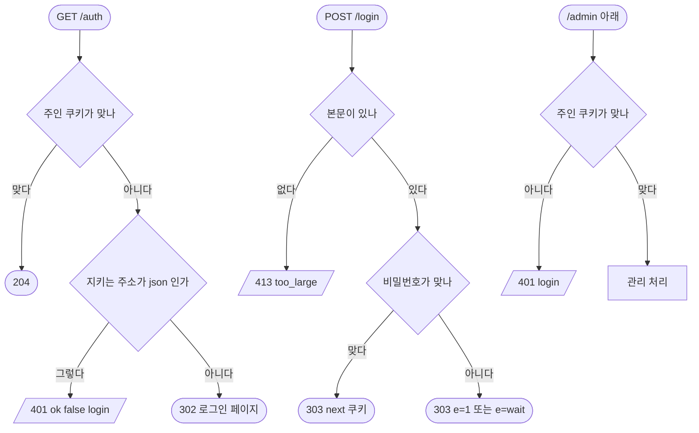

# 주인 로그인 · 관리 주소

## 시작점
Caddy 가 관리 페이지를 지키려고 `GET /auth` 를 부르고(`server/routes/owner.py:46`), 로그인 페이지가 `POST /login` · `POST /logout` 을 부른다. 관리 화면은 바깥 주소 `/api/admin/…` 로 부르고 서버에는 `/admin/…` 로 닿는다(`server/routes/admin.py:1`).

## 흐름도

## 단계
| 단계 | 화면 요소 또는 엔드포인트 | 근거 | 부르는 API | 오류 처리 | 기대 문구 |
|---|---|---|---|---|---|
| 문지기 | `GET /auth` | `server/routes/http.py:254` · `server/routes/owner.py:46` | 없음 | 401 · 302 | 204 · 401 `{ok:false,error:"login"}` · 302 |
| 돌아갈 곳 검사 | `X-Forwarded-Uri` | `server/routes/owner.py:23` | 없음 | 밖 주소는 `/admin/learning` 으로 | 302 `next=` |
| 주인 로그인 | `POST /login` | `server/routes/http.py:205` · `server/routes/http.py:208` · `server/routes/owner.py:59` | 없음 | 413 · 303 `e=` | 303 |
| 주인 로그아웃 | `POST /logout` | `server/routes/http.py:198` · `server/routes/owner.py:55` | 없음 | 없음 | 303 |
| 관리 읽기 | `GET /admin/*` | `server/routes/http.py:242` · `server/routes/http.py:244` | 없음 | 401 · 404 | `{error:{code:"login",…}}` |
| 관리 쓰기 | `POST /admin/*` | `server/routes/http.py:216` | 없음 | 401 | 같은 401 |
| 관리 지우기 | `DELETE /admin/*` | `server/routes/http.py:185` | 없음 | 401 | 같은 401 |
| 쿠키 뒤 처리 | `/admin/status` · `/admin/members…` | `server/routes/admin.py:78` · `server/routes/admin.py:81` | 없음 | 403 · 400 · 404 · 405 · 503 | 관리 응답 |

## 갈림길
- **문지기 페이지 쿠키 없음** — 페이지 주소면 302 로그인 페이지
- **문지기 자료 쿠키 없음** — `.json` 주소면 401
- **밖으로 보내는 next** — `//` 가 든 주소면 `next` 를 `/admin/learning` 으로 — TC 는 302 까지만 본다
- **주인 쿠키 맞음** — 맞으면 204
- **로그인 본문 없음** — 본문이 없으면 413
- **비밀번호 틀림** — 틀리면 303 로그인 페이지 `e=1`, 너무 많이 틀리면 `e=wait`
- **주인 로그인 성공** — 맞으면 303 쿠키
- **주인 로그아웃** — 쿠키를 지우고 303
- **관리 주소 쿠키 없음** — 읽기 · 쓰기 · 지우기 모두 401
- **관리 쿠키 뒤 처리** — 주인 쿠키가 있어야 도달하는 처리

## 끝점
204 · 302 · 303 또는 401 · 413 오류.

## 확인 필요
`Location` 은 실행기가 검사하지 않는다 — 행선지는 로컬 `curl` 로만 봤다. 시험 설정의 주인 인증 파일은 없는 경로(`SYUNG_AUTH_FILE`)라 어떤 입력으로도 로그인되지 않는다. `비밀번호 틀림` TC 는 비밀번호 칸 없는 본문을 보낸다. 쿠키 뒤 관리 처리 응답의 칸은 주인 쿠키가 있어야 확인된다.
