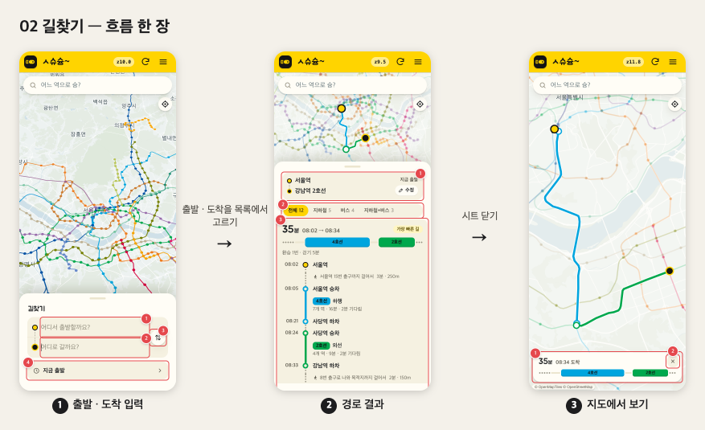
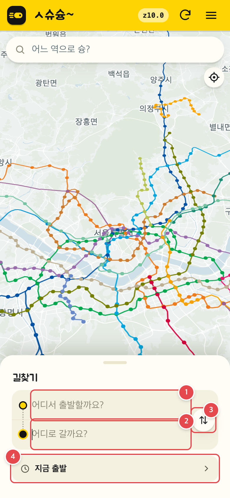
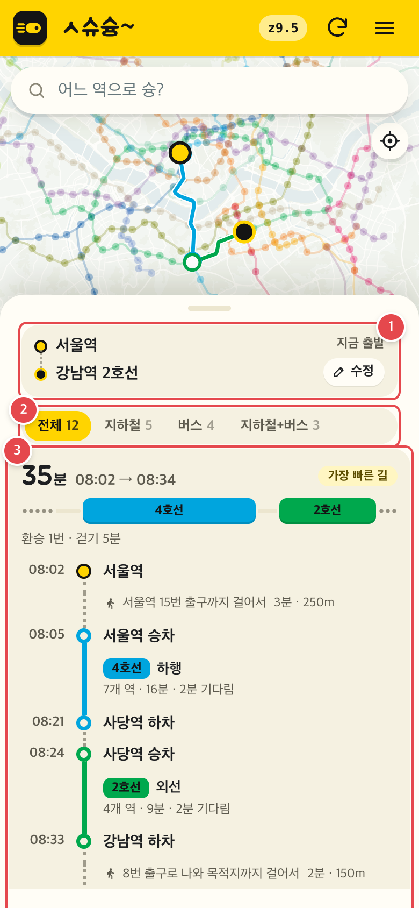
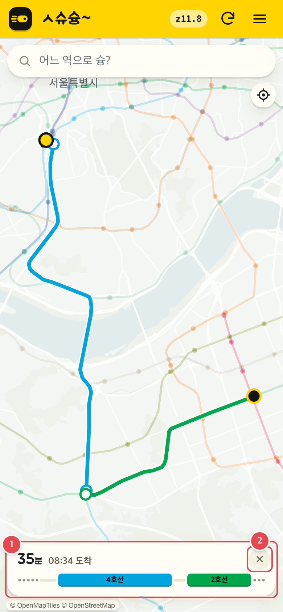
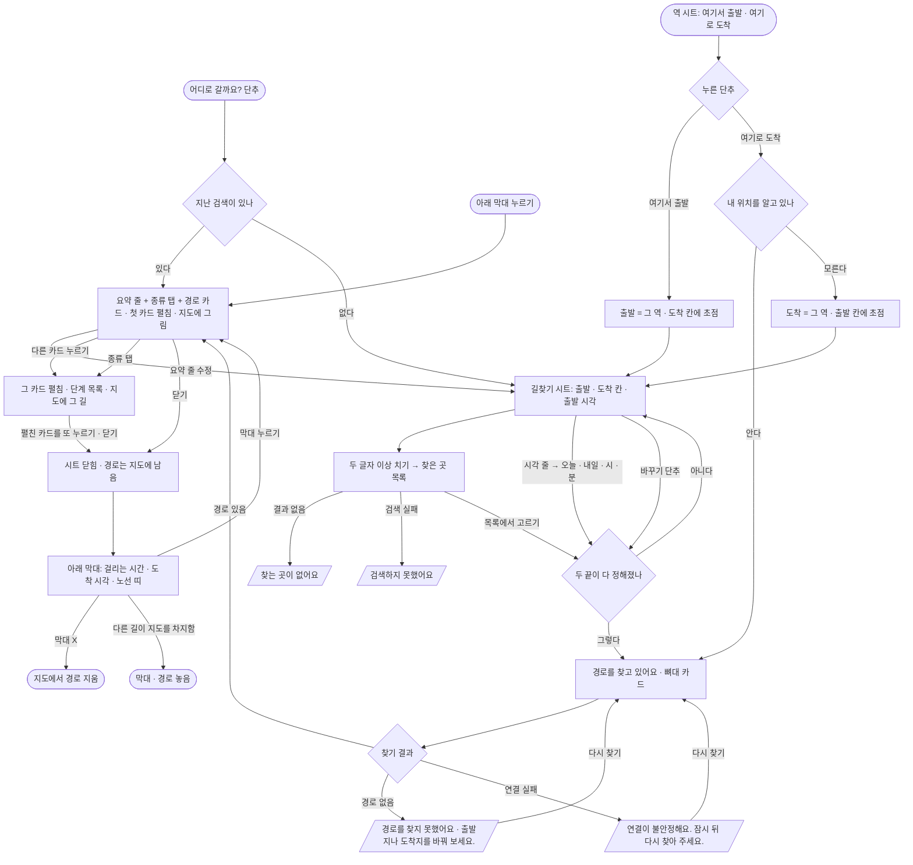

# 02 길찾기

출발 · 도착을 정하면 바로 경로를 찾고, 경로 카드를 골라 단계를 보고, 지도에 그린 채 시트를 닫으면 아래 막대로 다시 볼 수 있는 흐름. 로그인 없이 쓴다.

<!-- screens:start — tools/flows/capture.mjs 가 docs/flows/fe/screens/ 의 JSON 으로 다시 쓴다. 손으로 고치지 말 것 -->
## 화면 기획

흐름 한 장 — 폰 폭(390px) 실제 화면을 고정 자료로 찍었다(2026-11-02 월 07:30 · 지도 위 실시간 열차 없음).

### 1. 출발 · 도착 입력

지난 검색이 없을 때의 빈 칸. 두 끝이 정해지는 순간 바로 찾는다.

| 번호 | 무엇 | 누르면 | 예외 · 빈 상태 |
|---|---|---|---|
| 1 | 출발 칸 | 두 글자 이상 치면 0.3초 뒤 장소 목록 | 내 위치를 알면 「내 위치」로 차 있다 · 목록에서 안 고르면 「출발지를 목록에서 골라 주세요.」 |
| 2 | 도착 칸 | 출발 칸과 같다 | 결과 없음 「찾는 곳이 없어요」 · 실패 「검색하지 못했어요」 |
| 3 | 바꾸기 단추 | 출발 · 도착을 맞바꾼다 | — |
| 4 | 출발 시각 줄 — 기본 「지금 출발」 | 오늘 · 내일 · 시 · 분을 고른다. 「지금으로」 로 되돌린다 | 고를 수 있는 범위는 지금 1분 뒤 ~ 내일 23:50 |

### 2. 경로 결과

입력 칸이 요약 줄로 접히고, 첫 카드가 펼쳐져 지도에 그려진다.

| 번호 | 무엇 | 누르면 | 예외 · 빈 상태 |
|---|---|---|---|
| 1 | 요약 줄 — 출발 · 도착 · 시각 · 「수정」 | 입력 칸으로 돌아간다 | — |
| 2 | 종류 탭 — 전체 · 지하철 · 버스 · 지하철+버스 | 받은 길을 나눠 보여 준다 | 경로 종류가 둘 이상일 때만 · 고른 카드가 숨으면 첫 보이는 카드로 |
| 3 | 펼친 경로 카드 — 단계 목록 | 다시 누르면 시트가 닫히고 경로는 지도에 남는다. 다른 카드를 누르면 그 카드가 펼쳐지고 지도의 길도 바뀐다 | 경로 없음 「경로를 찾지 못했어요…」 · 연결 실패 「연결이 불안정해요…」 + 「다시 찾기」 |

### 3. 지도에서 보기

시트를 닫아도 경로는 지도에 남고 아래 막대가 뜬다.

| 번호 | 무엇 | 누르면 | 예외 · 빈 상태 |
|---|---|---|---|
| 1 | 아래 막대 — 걸리는 시간 · 도착 시각 · 노선 띠 | 경로 결과를 다시 연다 | 승차권 경로가 지도를 차지하면 막대 · 경로를 놓는다 |
| 2 | 막대 ✕ | 지도에서 경로를 지운다 | — |

<!-- screens:end -->

## 시작점
- 지도 위 단추 「어디로 갈까요?」(`#routeButton`) — 지난 검색이 있으면 그 결과로, 없으면 빈 칸으로 연다
- 역 시트의 「여기서 출발」 · 「여기로 도착」([01](01-map-search-station.md)) — 그 역을 한쪽 끝으로 채우고 새로 연다
- 경로를 그린 채 시트를 닫은 뒤 아래 막대 「경로 결과 다시 보기」

## 흐름도

## 단계
1. **열기** — 내 위치를 알고 있으면 출발 칸이 「내 위치」로 차 있고 옆에 위치 핀 단추가 있다. 모르면 출발 칸은 비어 있다(「어디서 출발할까요?」). 지난 검색이 있으면 그 결과 · 고른 카드 · 시각 그대로 접힌 요약으로 연다.
2. **장소 찾기** — 두 글자 이상 치면 0.3초 뒤 장소를 찾아 칸 아래 목록으로 보여 준다(늦게 온 답은 버린다). 고르면 칸이 채워지고 비어 있는 다른 칸으로 초점이 간다. 바꾸기 단추는 출발 · 도착을 맞바꾼다.
3. **출발 시각** — 기본 「지금 출발」. 시각 줄을 누르면 오늘 · 내일, 시 · 분 단추(누르고 있으면 계속 바뀐다)로 고르고 「이 시간에 출발」, 「지금으로」 로 되돌린다. 고를 수 있는 범위는 지금 1분 뒤 ~ 내일 23:50.
4. **찾기** — 두 끝이 정해지는 순간(장소 고르기 · 바꾸기 · 시각 정하기 · 역 시트에서 열기) 바로 찾는다. 찾는 동안 「경로를 찾고 있어요」와 뼈대 카드.
5. **경로 고르기** — 결과가 오면 입력 칸이 요약 줄(출발 · 도착 · 시각 · 「수정」)로 접히고, 첫 카드가 펼쳐져 지도에 그려진다. 경로 종류가 둘 이상이면 「전체 · 지하철 · 버스 · 지하철+버스」 탭이 뜬다(탭으로 고른 카드가 숨으면 첫 보이는 카드로).
6. **단계 보기** — 펼친 카드(`.jp.on`)에만 단계 목록이 보인다. 다른 카드를 누르면 그 카드가 펼쳐지고 지도의 길도 바뀐다.
7. **지도에서 보기** — 펼친 카드를 한 번 더 누르거나 시트를 닫으면 시트만 닫히고 경로는 지도에 남는다(안내 「경로를 누르면 지도에 보여요. 창을 닫아도 경로는 남아 있어요.」). 아래 막대가 뜬다.

## 갈림길
| 갈림길 | 동작 · 문구 |
|---|---|
| 불러오는 중 | 장소 찾기: 목록이 늦게 채워질 뿐 따로 표시 없음 / 경로: 「경로를 찾고 있어요」 + 뼈대 카드 |
| 경로 없음 | 「경로를 찾지 못했어요. {서버가 준 이유}」 — 이유가 없으면 「출발지나 도착지를 바꿔 보세요.」 · 「다시 찾기」 단추 |
| 연결 실패 | 「경로를 찾지 못했어요. 연결이 불안정해요. 잠시 뒤 다시 찾아 주세요.」 · 「다시 찾기」 |
| 장소 검색 실패 · 결과 없음 | 목록에 「검색하지 못했어요」(서버가 준 글이 있으면 그 글) · 「찾는 곳이 없어요」 |
| 위치 권한 없음 | 출발 칸이 비어 있고 위치 핀이 없다. 출발 칸에 「내 위치」라고 남아 있는데 위치가 없으면 찾기 전에 「출발지를 목록에서 골라 주세요.」 |
| 끝을 목록에서 안 고름 | 「출발지를 목록에서 골라 주세요.」 · 「도착지를 목록에서 골라 주세요.」 |
| 실시간 자료 끊김 | 길찾기 화면에는 따로 없다 — 지도 위 띠는 [01](01-map-search-station.md) 그대로. 경로 카드 안내 「첫 열차는 실시간 위치로, 이후 열차는 배차 간격으로, 버스는 시간표로 계산한 예상 시간이에요.」 |
| 로그인 안 됨 | 해당 없음(로그인한 사람만 길찾기 횟수를 통계로 센다 — [04](04-account.md)) |

## 끝점
- 아래 막대 ✕ → 지도에서 경로를 지운다
- 승차권 경로(지도에서 보기 · 경로 고르기 — [03](03-tickets.md))가 지도를 차지하면 길찾기 경로 · 막대를 놓는다. 「어디로 갈까요?」를 누르면 반대로 승차권 경로를 지운다
- 역 · 열차 시트가 길찾기 시트 자리를 차지하면 경로는 남고 막대가 뜬다

## 관련 코드
| 무엇 | 경로:줄 |
|---|---|
| 시작 단추 · 연결(승차권 길 지우기) | `web/index.html:51` · `web/maplibre_runtime.mts:595-597` · `web/lib/journey-ui.mts:420` |
| 아래 막대(다시 보기 · ✕) | `web/lib/journey-ui.mts:160-165` · `web/lib/journey-ui.mts:405-412` |
| 처음 모양(내 위치) | `web/lib/journey-ui.mts:171` · `web/ui/journey_sheet.tsx:141-142` |
| 출발 시각 | `web/lib/journey-ui.mts:177-231` · `web/ui/journey_sheet.tsx:36-54` |
| 장소 찾기 | `web/lib/journey-ui.mts:235-253` |
| 두 끝이 정해지면 찾기 · 내 위치 | `web/lib/journey-ui.mts:254-264` |
| 종류 탭 · 카드 고르기 · 펼친 카드 다시 누르기 | `web/lib/journey-ui.mts:285-315` |
| 찾기 · 실패 문구 · `/api/route` | `web/lib/journey-ui.mts:317-345` |
| 지난 검색 열기 · 역 시트에서 열기 | `web/lib/journey-ui.mts:368-402` |
| 승차권 쪽이 지도를 차지함 | `web/lib/journey-ui.mts:418` · `web/maplibre_runtime.mts:597` |
| 카드 · 단계 목록 · 실패 카드 · 요약 줄 | `web/ui/journey_sheet.tsx:104-138` |
| 역 시트 두 단추 → 길찾기 | `web/ui/sheet.mts:124-125` |

## 확인 필요
- **TC S-1(연결 실패) 미완료** — 2026-10-30 `run.mjs --layer fe` 첫 실행(기록 `.qa-runs/20261030-122456-qa`)은 실행기가 Node 24.18 `undici` `assert(!this.paused)` 로 죽어 결과 없이 끝났다(`finishedAt` 없음 · 상태 running). 두 번째 실행은 무거운 명령 차례를 7분 넘게 기다리다 지시로 껐다(TC 시작 전). 통과 · 실패를 확인하지 못했다
- S-1 의 mock 문구 「테스트 이유」는 시험용 값이고, 이 파일의 나머지 갈림길 TC 는 아직 없다
