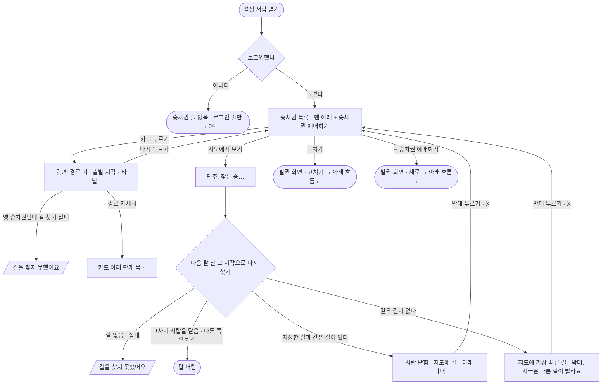
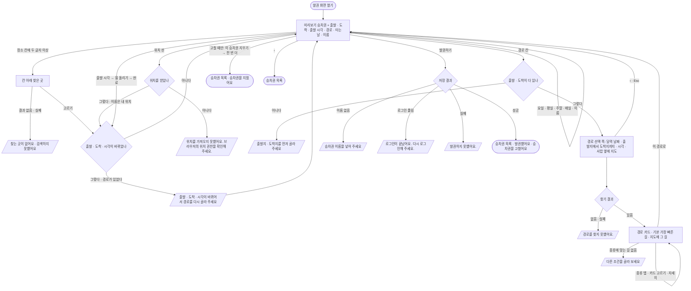

# 03 승차권 — 목록 · 뒤집기 · 지도에서 보기 · 발권 · 고치기

매일 타는 길을 「승차권」으로 저장해 두고(장소 · 출발 시각 · 경로 · 타는 날 · 이름), 목록에서 뒤집어 경로를 보거나 지도에 그려 보는 흐름. **로그인한 사람만** 쓴다. 모두 설정 서랍 안의 쪽(목록 `#menuTickets` → 발권 `#menuTicket` → 경로 선택 `#menuRoute`)에서 일어난다.

화면 기획(조립 화면 · 번호 설명 · 흐름 한 장)은 스토리북 **화면 기획** 에 있다 — `npm run storybook` → [`화면-기획--flow-03`](http://localhost:6006/?path=/story/화면-기획--flow-03). 설명 원본은 `docs/flows/fe/screens/03-tickets/*.json`.

## 시작점
- 설정 서랍 목록의 「승차권」 줄(`#ticketsRow`) — 로그인했을 때만 보인다

## 흐름도 — 목록 · 뒤집기 · 지도에서 보기

## 흐름도 — 발권 · 고치기

## 단계
| 단계 | 화면 요소 또는 엔드포인트 | 근거 | 부르는 API | 오류 처리 | 기대 문구 |
|---|---|---|---|---|---|
| 목록 | `#ticketsRow` · `#ticketList` · `.ticket` | `web/user/account.mts:374-376` · `web/components/settings.tsx:108` · `web/components/ticket_card.tsx:61` | GET `/api/me/tickets` | 401 이면 로그인 안 됨 처리 | + 승차권 예매하기 |
| 뒤집기 | `.ticket.flipped` · `.tk-steps-btn` · `.tk-steps` | `web/user/account.mts:106-130` · `web/components/ticket_card.tsx:47-55` | GET `/api/route`(옛 승차권만) | 못 찾으면 안내(줄 127) | 길을 찾지 못했어요 |
| 지도에서 보기 | `.tk-map` · 아래 막대 | `web/user/account.mts:642-650` · `web/user/account.mts:692-697` | GET `/api/route` | 못 찾으면 토스트 | 승차권으로 · 지금은 다른 길이 빨라요 |
| 발권 화면 열기 | `#ticketNew` · `.tk-edit` · `#ticketPreview` | `web/user/account.mts:702` · `web/components/ticket_card.tsx:62` · `web/components/ticket_form.tsx:19` |  |  |  |
| 장소 | `#ticketFrom` · `#ticketTo` · `.tf-list li button` · `#ticketFromHere` | `web/user/account.mts:411-427` · `web/components/place_field.tsx:14` · `web/components/place_field.tsx:36` | GET `/api/place` | 목록에 안내(`li.empty`) | 찾는 곳이 없어요 |
| 경로 선택 | `#ticketRoute` · `#routeList` · `#routePick` | `web/user/account.mts:547` · `web/user/account.mts:550` · `web/user/account.mts:558` · `web/user/account.mts:569` · `web/components/route_picker.tsx:38-46` | GET `/api/route` | `#routeMsg` 에 이유 | 출발지 · 도착지를 먼저 골라 주세요 |
| 저장 | `#ticketName` · `#ticketSave` | `web/user/account.mts:711-728` · `web/components/ticket_form.tsx:27-29` | POST `/api/me/tickets` · PUT `/api/me/tickets/{id}` | 401 · 서버 글 토스트(줄 722-728) | 발권했어요 · 승차권을 고쳤어요 |
| 지우기 | `#ticketDelete` | `web/user/account.mts:731-740` · `web/components/ticket_form.tsx:30` | DELETE `/api/me/tickets/{id}` | 실패 토스트 | 한 번 더 누르면 지워요 · 승차권을 지웠어요 |

### 자세히
1. **목록** — 회원 코드를 받을 때(지도가 다 그려진 뒤 또는 메뉴 단추를 처음 누를 때) 로그인한 상태면 승차권을 받아 둔다(저장 · 지우기 뒤에도 다시 받는다). 카드 앞면: 이름 · 출발 시각 · 일련번호(번호 · 요일 · 시각) · 오늘 타는 날이면 「오늘」. 맨 아래 「+ 승차권 예매하기」.
2. **뒤집기** — 카드를 누르면 뒷면. 저장한 경로가 있으면 그 경로 띠, 없으면(옛 승차권) 다음 탈 날 그 시각으로 찾아 가장 빠른 길을 띠로 그린다. 「경로 자세히」로 단계 목록을 펼친다.
3. **지도에서 보기** — 뒷면의 단추. 저장한 경로에는 지도에 그릴 길 모양이 없어 다음 탈 날 그 시각으로 다시 찾는다. 같은 길이 있으면 그 길, 없으면 가장 빠른 길 + 「지금은 다른 길이 빨라요」. 서랍이 닫히고 지도에 길, 아래 막대(「‹ 승차권으로」). 막대 · ✕ 를 누르면 서랍 · 목록 · 그 카드로 돌아온다.
4. **발권 화면 열기** — 「+ 승차권 예매하기」(새로 · 출발 시각 08:00 · 타는 날 없음) 또는 「고치기 ›」(그 승차권 값). 위쪽 미리보기 승차권이 고치는 대로 바뀐다.
5. **장소** — 출발 · 도착 칸에 두 글자 이상 치면 0.3초 뒤 칸 아래 목록. 출발을 고르면 도착 칸으로 초점이 간다. 위치 핀은 본체가 아는 위치를, 없으면 한 번 물어 그 칸을 「내 위치」로 채운다.
6. **출발 시각** — 휠(오전 · 오후 / 시 / 분 5분 단위)을 돌리고 「완료」. 돌리는 동안은 미리보기만 바뀌고, 접을 때 시각이 바뀌었으면 고른 경로를 푼다.
7. **경로 선택** — 「경로」 칸을 누르면 경로 선택 쪽으로 간다. 머리말은 달력 날짜(고른 요일 중 가장 가까운 날 — 없으면 오늘, 시각이 지났으면 다음 날) · 「출발지에서 → 도착지까지」 · 「오전 HH:MM 출발 · 이 시각 출발 기준으로 찾은 경로」. 같은 길 모양은 가장 빠른 것 하나로 묶고, 처음에는 저장한 경로(고칠 때) 또는 「가장 빠른 길」이 골라져 있다. 서랍이 지도 옆(휴대폰은 반쪽 시트)으로 비켜 고른 카드의 길을 지도에 그린다. 종류 탭은 받은 길을 다시 나눌 뿐 다시 찾지 않는다. 「이 경로로」를 누르면 발권 화면으로 돌아가 경로 칸에 「약 N분 · 환승 N」.
8. **타는 날 · 이름** — 요일 단추와 「평일 · 주말 · 매일」. 이름은 12자까지.
9. **저장** — 경로를 고르기 전에는 「발권하기」가 꺼져 있다. 누르면 「발권하는 중…」 → 성공하면 목록으로 가서 「발권했어요」(고칠 때 「승차권을 고쳤어요」).
10. **지우기** — 고칠 때만 「이 승차권 지우기」. 한 번 누르면 「한 번 더 누르면 지워요」, 또 누르면 지우고 목록으로 「승차권을 지웠어요」.

## 갈림길
- **로그인 안 됨** — 서랍에 「승차권」 줄이 없다(→ [04](04-account.md) 로그인). 저장 · 지우기 중 로그인이 풀리면(401) 「로그인이 끝났어요. 다시 로그인해 주세요.」 · 회원 줄이 로그인 줄로 바뀐다
- **불러오는 중** — 뒷면 경로 띠: 찾는 동안 「출발 → 도착」 이름만 / 지도에서 보기 단추 「찾는 중…」 / 경로 선택 「경로를 찾고 있어요」 + 뼈대 카드 / 저장 「발권하는 중…」
- **목록 · 뒤집기** — 카드를 누르면 뒷면, 「경로 자세히」로 단계 목록
- **경로 없음** — 경로 선택: 서버가 준 이유 또는 「경로를 찾지 못했어요.」, 연결 실패 「경로를 찾지 못했어요. 연결을 확인해 주세요.」 / 지도에서 보기 「길을 찾지 못했어요」(연결 실패는 「…연결을 확인해 주세요.」) / 뒷면 「길을 찾지 못했어요」
- **종류 탭에 맞는 길 없음** — 「다른 조건을 골라 보세요」
- **지도에서 보기** — 같은 길이 있으면 그 길, 없으면 가장 빠른 길 + 「지금은 다른 길이 빨라요」. 막대 글 「‹ 승차권으로」
- **장소 찾기 실패 · 결과 없음** — 칸 아래 「찾는 곳이 없어요」 · 「검색하지 못했어요」
- **위치 권한 없음** — 위치 핀: 「위치를 가져오지 못했어요. 브라우저의 위치 권한을 확인해 주세요.」
- **출발 시각 휠** — 돌리는 동안 미리보기만 바뀌고, 접을 때 시각이 바뀌었으면 고른 경로를 푼다
- **경로가 풀림** — 출발 · 도착 · 시각이 바뀌면 「출발 · 도착 · 시각이 바뀌어서 경로를 다시 골라 주세요」
- **경로 선택 Esc** — 서랍을 닫지 않고 발권 화면으로 돌아간다
- **빠진 칸** — 「출발지 · 도착지를 먼저 골라 주세요」(경로 칸) · 「출발지 · 도착지를 골라 주세요」 · 「경로를 골라 주세요」 · 「승차권 이름을 넣어 주세요」
- **저장 성공** — 목록으로 가서 「발권했어요」(고칠 때 「승차권을 고쳤어요」)
- **지우기** — 한 번 누르면 「한 번 더 누르면 지워요」, 또 누르면 「승차권을 지웠어요」
- **저장 · 지우기 실패** — 서버가 준 글 또는 「발권하지 못했어요.」 · 「지우지 못했어요.」(연결 실패는 「…연결을 확인해 주세요.」)
- **서랍 닫기** — 찾던 답은 버린다
- **실시간 자료 끊김** — 해당 없음(승차권 경로는 `/api/route` 로 찾는다)

## 끝점
- 저장 · 지우기 성공 → 승차권 목록 + 토스트
- 지도에서 보기 → 지도 + 아래 막대 → 막대를 누르면 목록으로
- 서랍 닫기(✕ · Esc · 바깥 누르기) — 찾던 답은 버린다. 경로 선택 쪽의 Esc 는 서랍을 닫지 않고 발권 화면으로
- 다른 길(길찾기 · 버스 노선)이 지도를 차지하면 승차권 길 · 막대를 치운다

## 관련 코드
| 무엇 | 경로:줄 |
|---|---|
| 서랍의 승차권 줄 · 세 쪽 | `web/components/settings.tsx:108` · `web/index.html:72-74` · `web/user/tickets_view.tsx:121` |
| 목록 받기 · 뒷면 경로 | `web/user/account.mts:374-376` · `web/user/account.mts:106-130` |
| 카드 · 목록 쪽 | `web/components/ticket_card.tsx:47-62` · `web/user/tickets_view.tsx:79-85` |
| ‹ 차례 | `web/user/account.mts:378-387` |
| 경로 풀림 | `web/user/account.mts:397` · `web/user/account.mts:436` |
| 장소 찾기 · 위치 핀 | `web/user/account.mts:411-438` · `web/user/account.mts:465` |
| 경로 찾기 · 고르기 | `web/user/account.mts:547-569` |
| 경로 선택 쪽 지도 · Esc | `web/user/account.mts:598-622` |
| 지도에서 보기 · 아래 막대 | `web/user/account.mts:642-650` · `web/user/account.mts:692-697` |
| 발권 화면 열기 · 저장 · 지우기 | `web/user/account.mts:702-740` |
| 발권 · 경로 선택 그리기 | `web/components/ticket_form.tsx:19-30` · `web/components/route_picker.tsx:34-46` |

## 확인 필요
- 쓰기(발권 · 고치기 · 지우기)는 모두 mock 이라 운영 자료를 건드리지 않는다
- TICKET-22(종류 탭에 맞는 길 없음)는 어떤 응답으로 닿는지 정하지 못해 manual 로 뒀다 — `web/user/ticket_routes.mts` 의 셈을 돌려 봐야 한다
- **타는 날 없이 저장된다** — 새 승차권은 타는 날이 비어 있고, 저장 때 요일을 검사하지 않는다(서버도 빈 목록을 받는다 `server/services/members.py:237-241`). 뒷면에는 「타는 날 없음」으로 보인다. 요일을 꼭 고르게 할지 정책 확인 필요
- 경로 선택 쪽 Esc 근처(`web/user/account.mts:622`) 주석에 「경유지 목록이 펼쳐져 있으면 목록이 먼저」가 남아 있다 — 경유지는 #127 에서 빠졌고 코드가 보는 것은 장소 목록(`placeFor`)이다. 주석만 옛 글로 보인다(동작 영향 없음 · 고치지 않음)
- 서버의 발권 본문에는 아직 `via`(경유지) 칸이 있다(`server/services/members.py:242` · `server/routes/members.py:27`) — 웹은 보내지 않는다. 서버 쪽에서 남겨 둘지는 syung-be 확인 필요
