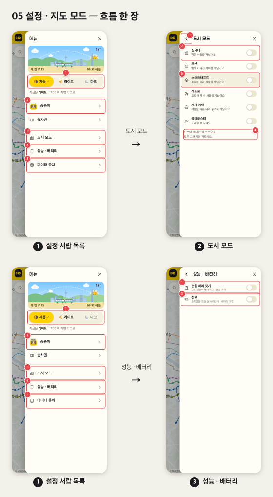
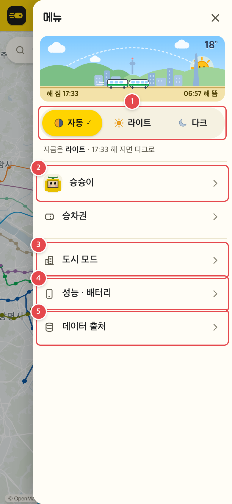
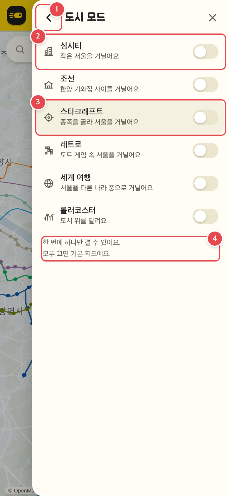
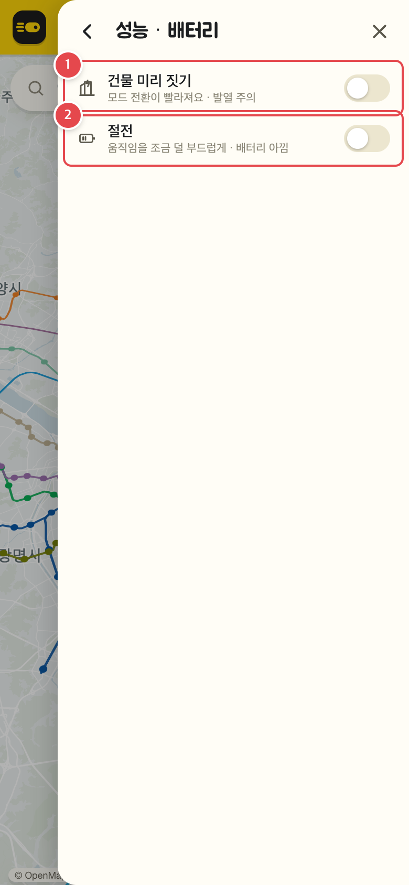
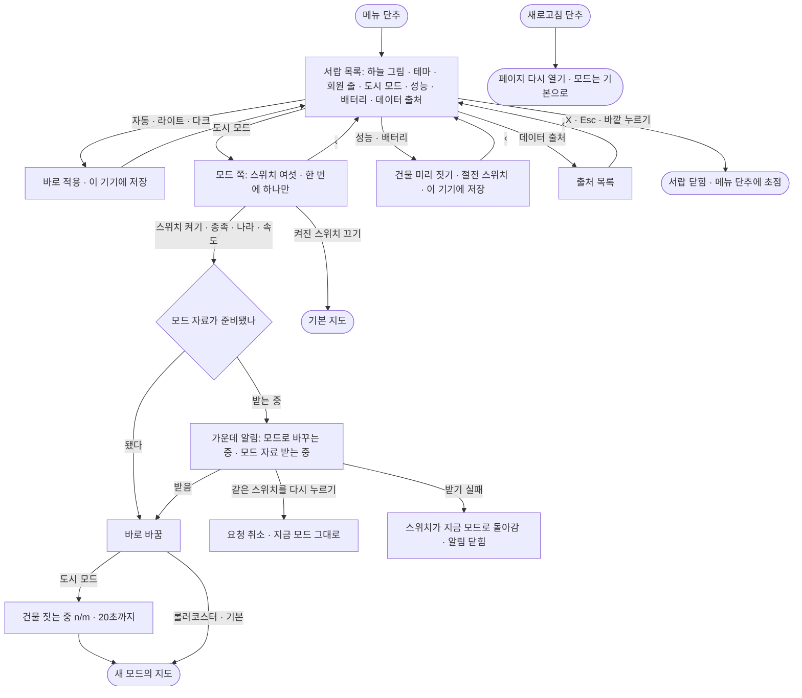

# 05 설정 · 지도 모드

머리줄의 메뉴 단추로 오른쪽 설정 서랍을 열어 테마를 고르고, 도시 모드(심시티 · 조선 · 스타크래프트 · 레트로 · 세계 여행 · 롤러코스터)를 켜고 끄고, 기기 설정(건물 미리 짓기 · 절전)과 데이터 출처를 보는 흐름. 회원 줄(로그인 · 내 정보 · 승차권)은 [04](04-account.md) · [03](03-tickets.md).

<!-- screens:start — tools/flows/capture.mjs 가 docs/flows/fe/screens/ 의 JSON 으로 다시 쓴다. 손으로 고치지 말 것 -->
## 화면 기획

흐름 한 장 — 폰 폭(390px) 실제 화면을 고정 자료로 찍었다(2026-11-02 월 07:30 · 지도 위 실시간 열차 없음).

### 1. 설정 서랍 목록

메뉴 단추를 누르면 오른쪽에서 밀려 나온다. 늘 목록부터 보인다.

| 번호 | 무엇 | 누르면 | 예외 · 빈 상태 |
|---|---|---|---|
| 1 | 테마 — 자동 · 라이트 · 다크 | 바로 적용하고 이 기기에 저장 | 자동은 5분마다 다시 판단 |
| 2 | 내 정보 줄 | 내 정보(04) | 로그인 안 됐으면 「로그인」 줄 · 로그인 방법이 없으면 회원 칸 전체 숨김 |
| 3 | 도시 모드 | 모드 쪽 | — |
| 4 | 성능 · 배터리 | 기기 설정 쪽 | — |
| 5 | 데이터 출처 | 출처 목록(글만 있는 쪽) | — |

### 2. 도시 모드

스위치 여섯, 한 번에 하나만. 모두 끄면 기본 지도.

| 번호 | 무엇 | 누르면 | 예외 · 빈 상태 |
|---|---|---|---|
| 1 | ‹ 목록으로 | 목록으로 돌아가 누른 항목에 초점 | — |
| 2 | 모드 스위치 | 켜면 그 모드로 바꾼다. 받는 중 다시 누르면 요청 취소 | 자료를 받는 동안 가운데 알림 「…로 바꾸는 중」 · 도시 모드는 「건물 짓는 중 n/m」(20초까지) · 받기 실패면 스위치만 돌아간다(안내 없음) |
| 3 | 스타크래프트 | 켜면 아래에 종족 줄(테란 · 저그 · 프로토스) | 세계 여행은 나라 줄, 롤러코스터는 열차 속도 줄이 열린다 |
| 4 | 안내 — 「한 번에 하나만 켤 수 있어요. 모두 끄면 기본 지도예요.」 | — | — |

### 3. 성능 · 배터리

둘 다 이 기기에 저장한다.

| 번호 | 무엇 | 누르면 | 예외 · 빈 상태 |
|---|---|---|---|
| 1 | 건물 미리 짓기 | 켜면 바로 한 번 짓는다 | 처음 값은 휴대폰 끔 · 컴퓨터 켬 |
| 2 | 절전 | 움직임을 1초 20번으로 | — |

<!-- screens:end -->

## 시작점
- 머리줄 메뉴 단추(`#settingsButton`) — 열 때마다 목록(`#menuRoot`)부터
- 머리줄 새로고침 단추(`#refreshButton`) — 페이지를 다시 연다

## 흐름도

## 단계
| 단계 | 화면 요소 또는 엔드포인트 | 근거 | 부르는 API | 오류 처리 | 기대 문구 |
|---|---|---|---|---|---|
| 서랍 열기 | `#settingsButton` · `#settingsPanel` · `#menuRoot` | `web/index.html:49` · `web/index.html:63` · `web/index.html:66` · `web/maplibre_runtime.mts:972` |  |  |  |
| 테마 | `[data-theme-choice]` · `#themeNote` | `web/components/settings.tsx:38-43` · `web/map/theme.mts:54` · `web/user/prefs.mts:7` |  |  | 자동 · 라이트 · 다크 |
| 쪽 이동 | `[data-menu-page]` · `#menuBack` | `web/components/settings.tsx:113-115` · `web/components/drawer.tsx:10` |  |  | 도시 모드 |
| 도시 모드 | `#toggleSimcity` · `#toggleJoseon` · `#toggleStarcraft` · `#toggleRetro` · `#toggleNation` · `#toggleCoaster`(`aria-pressed`) | `web/components/settings.tsx:67-80` · `web/components/drawer.tsx:28-29` · `web/maplibre_runtime.mts:923-936` |  | 준비 실패면 스위치만 되돌림 | 한 번에 하나만 켤 수 있어요. 모두 끄면 기본 지도예요. |
| 바꾸는 중 | 가운데 알림 | `web/maplibre_runtime.mts:858` · `web/maplibre_runtime.mts:865-883` · `web/modes/transition.mts:28-38` |  | 받는 중 다시 누르면 취소 | 모드 자료 받는 중 |
| 성능 · 배터리 | `#togglePrebuild` · `#toggleSaver` | `web/components/settings.tsx:87-88` · `web/maplibre_runtime.mts:939-944` |  |  | 건물 미리 짓기 · 절전 |
| 데이터 출처 | `#menuSources` | `web/index.html:70` · `web/ui/settings_menu.tsx:75` |  |  |  |
| 서랍 닫기 | `#settingsClose` · Esc · `.menu-scrim` | `web/maplibre_runtime.mts:975-977` · `web/maplibre_runtime.mts:984` · `web/index.html:78` |  |  |  |
| 새로고침 | `#refreshButton` | `web/index.html:49` · `web/maplibre_runtime.mts:948` |  |  |  |

### 자세히
1. **서랍 열기** — 메뉴 단추를 누르면 오른쪽에서 서랍이 밀려 나온다(동작 줄이기면 미끄러짐 없이). 늘 목록부터 보이고 ✕ 에 초점. 열려 있는 동안 Tab 은 서랍 안에서만 돈다.
2. **테마** — 맨 위 하늘 그림(고른 테마와 상관없이 지금 실제 낮 · 밤)과 「자동 · 라이트 · 다크」. 누르면 바로 적용하고 이 기기에 저장한다(`subway-theme`). 자동은 5분마다 다시 판단한다.
3. **쪽 이동** — 목록 항목을 누르면 그 쪽만 보이고 머리 제목이 그 이름이 된다. ‹ 로 목록에 돌아와 누른 항목에 초점.
4. **도시 모드** — 「심시티 · 조선 · 스타크래프트 · 레트로 · 세계 여행 · 롤러코스터」 스위치. 「한 번에 하나만 켤 수 있어요. 모두 끄면 기본 지도예요.」 스타크래프트를 켜면 종족 줄(테란 · 저그 · 프로토스 · 처음은 테란, 그다음은 마지막에 고른 종족), 세계 여행은 나라 줄(그리스 · 네덜란드 · 파리 · 이집트), 롤러코스터는 열차 속도 줄(1 · 5 · 20배)이 아래에 열린다.
5. **바꾸는 중** — 모드 코드 · 자료가 아직 없으면 가운데 알림 「{모드}로 바꾸는 중」 + 「모드 자료 받는 중」(롤코 처음은 「롤코 자료 받는 중」). 도시 모드는 바꾼 뒤 「건물 짓는 중 n/m」 막대를 다 지을 때까지(20초까지) 보인다. 받는 중에 같은 스위치를 다시 누르면 요청을 취소한다.
6. **끄기** — 켜진 스위치를 끄면 기본 지도로 돌아간다.
7. **성능 · 배터리** — 「건물 미리 짓기」(모드 전환이 빨라져요 · 발열 주의 — 처음 값은 휴대폰 끔 · 컴퓨터 켬, 켜면 바로 한 번 짓는다) · 「절전」(움직임을 1초 20번으로). 둘 다 이 기기에 저장(`subway-prebuild` · `subway-saver`).
8. **데이터 출처** — 노선 · 역 · 시간표 등 자료 출처 목록(글만 있는 쪽).

## 갈림길
- **서랍 닫기** — ✕ · Esc · 바깥 누르기로 닫고 초점은 메뉴 단추로
- **테마** — 고르면 바로 적용하고 그 칸이 눌린 모양(`aria-pressed`)
- **쪽 이동** — 목록 항목으로 그 쪽, ‹ 로 목록
- **모드 켜고 끄기** — 한 번에 하나만. 다른 모드를 켜면 먼저 켠 것이 꺼지고, 켜진 스위치를 끄면 기본 지도
- **딸린 줄** — 스타크래프트는 종족, 세계 여행은 나라, 롤러코스터는 열차 속도 줄이 열린다
- **성능 · 배터리** — 건물 미리 짓기 · 절전. 이 기기에 저장
- **데이터 출처** — 자료 출처 목록(글만 있는 쪽)
- **새로고침** — 페이지를 다시 연다
- **불러오는 중** — 모드 바꾸기 가운데 알림 「…로 바꾸는 중」 · 「모드 자료 받는 중」 · 「롤코 자료 받는 중」 · 「건물 짓는 중 n/m」
- **받는 중 다시 누르기** — 같은 스위치를 다시 누르면 요청을 취소하고 지금 모드 그대로
- **모드 준비 실패** — 스위치가 지금 모드로 돌아가고 알림이 닫힌다(화면 안내 문구 없음 — 아래 확인 필요)
- **로그인 안 됨** — 서랍 목록에 「로그인」 줄([04](04-account.md)) — 테마 · 모드 · 기기 설정은 로그인과 상관없다
- **승차권 경로 선택 중** — 서랍이 지도 옆으로 비킨 상태(`.with-map`)에서는 지도 · 서랍 · 지도 단추 · 아래 시트를 눌러도 서랍이 닫히지 않는다([03](03-tickets.md))
- **경로 없음 · 위치 권한 없음 · 실시간 자료 끊김** — 해당 없음

## 끝점
- 서랍 닫힘(✕ · Esc · 바깥 누르기) — 초점은 메뉴 단추로
- 새 모드의 지도 / 기본 지도
- 새로고침 — 페이지를 다시 연다. 테마 · 기기 설정은 남고 모드는 기본으로 시작한다(아래 확인 필요)

## 관련 코드
| 무엇 | 경로:줄 |
|---|---|
| 서랍 · 목록 · 쪽 껍데기 | `web/index.html:61-74` |
| 서랍 열기 · 닫기 · 쪽 이동 · Esc · Tab · 바깥 누르기 | `web/maplibre_runtime.mts:949-992` |
| 새로고침 단추 | `web/maplibre_runtime.mts:948` |
| 테마 그리기 · 저장 | `web/ui/settings_menu.tsx:37-43` · `web/map/theme.mts:54` |
| 모드 스위치 · 종족 · 나라 · 속도 그리기 | `web/components/settings.tsx:67-80` |
| 모드 상태의 주인(요청 · 취소 · 실패) | `web/modes/transition.mts:28-38` · `web/maplibre_runtime.mts:409-410` |
| 모드 준비 · 바꾸는 중 알림 | `web/maplibre_runtime.mts:858-883` |
| 모드 바꾸기 · 끄기 · 스위치 연결 | `web/maplibre_runtime.mts:891-936` |
| 건물 미리 짓기 · 절전 | `web/components/settings.tsx:87-88` · `web/maplibre_runtime.mts:939-944` |
| 기기 저장 이름 | `web/user/prefs.mts:7` |

## 확인 필요
- **TC 는 아직 돌리지 않았다** — 선택자 · 문구는 소스와 대조만 했다. 모드 스위치 TC 가 지도 · 모드 코드 준비에 달려 있어 10초 안에 끝나는지 확인 필요
- **모드는 새로고침하면 기본으로 돌아온다** — 저장 이름 목록(`web/user/prefs.mts:7`)에 모드가 없어 고른 모드를 기억하지 않는다. 의도된 동작인지 확인 필요
- **모드 준비 실패에 안내가 없다** — 자료 받기가 실패하면 스위치만 지금 모드로 돌아가고 콘솔 오류만 남는다(`web/modes/transition.mts:35` · `web/maplibre_runtime.mts:409-410`). 사람에게 알릴지 확인 필요
- 지도 색(`subway-map-color` — calm · color) 저장 이름은 있지만 고르는 화면이 서랍에 없다(값은 모드 설정 `web/modes/basic/index.mts:13` 에서만 온다). 화면을 만들 계획인지 확인 필요
- 롤러코스터의 열차 타기(열차 시트의 자리 고르기 · 타기)는 이번 흐름 목록에 없어 적지 않았다
